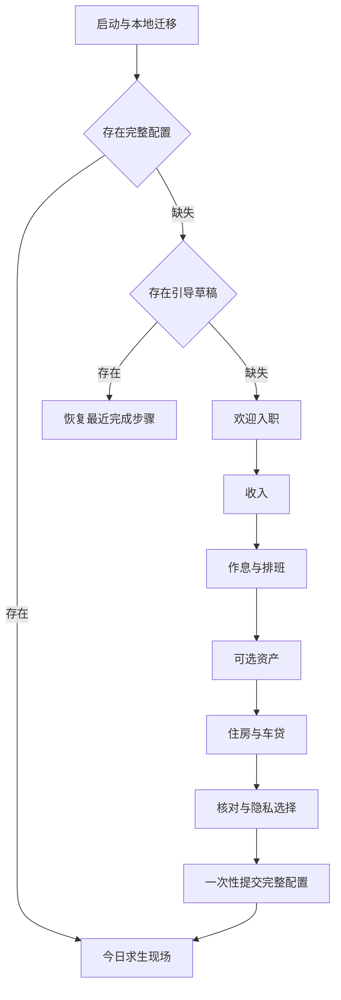

# 产品需求设计

版本 0.2 · 2026-11-04 · 状态为可进入开发拆解。

## 1. 产品定位

面向有固定工作排班、工资收入、投资或固定支出的中文用户。用户打开 App 能看到工资逐步增长，同时直观看到行情变化和住房、车贷带来的压力。丧萌办公室角色提供戏谑与陪伴感。

产品名暂用“今日又白干”。暂定名可在品牌注册与商店建档前更改，业务契约使用内部名称 FJOB。

核心成功条件是新用户能独立完成工资及排班录入，首页每个分项可追溯，前后台切换后金额正确，小部件具备清楚的数据时间与隐私状态。

## 2. 发布范围和工程默认

| 范围 | 首版要求 | 优先级 |
| --- | --- | --- |
| 首次引导 | 六步录入、草稿恢复、可选项跳过、最终确认 | P0 |
| 工资排班 | 到手月薪、周模板、日期覆盖、午休、跨夜班、月内生效版本 | P0 |
| 今日现场 | 综合值、四类分项、下班倒计时、手绘动画和统计说明 | P0 |
| 资产 | 沪深京A股多持仓、按克黄金、自动报价、今日与持有盈亏 | P0 |
| 固定支出 | 单个住房方案，房贷/房租/暂无互斥，独立车贷 | P0 |
| 小部件 | Android 与 iOS，三种信息密度、隐藏金额、深链 | P0 |
| 数据管理 | 本地持久化、版本迁移、删除账本、编辑历史及配置 | P0 |
| 发版 | Android 签名产物，iOS CI 签名并上传 TestFlight | P0 |
| 上线后扩展 | 港美股、交易流水、自动税费、跨设备同步、多套住房 | P1 |
| 后续贷款能力 | 按本金/利率/期数生成还款计划、利率调整和提前还款 | P1 |

首版先以用户账单中“当月应付金额”统计，贷款计算器为后续能力。月供分摊为压力估算，明细明确其本金成分。房租独立标记为租金。

工程默认支持 Android 8.0/API 26 起、iOS 16 起。工具链建项时验证依赖和平台最低版本，写入锁定配置。界面为简体中文、人民币、工资时区 Asia/Shanghai，设备时区改变时统计时区保持用户设置值。

## 3. 首次进入流程

### ONB-01 欢迎

标题“入职手续，生活替你准备好了。”正文说明工资与排班必填，资产、住房和车贷按需填写。主按钮“办理入职”。次按钮“先替示例打工人焦虑一下”。

示例模式采用独立内存或命名空间数据，固定演示时钟并显示模拟标识。退出示例后回到原账本或未完成引导。示例数据不得写入正式账本。新用户无登录与行情密钥输入步骤。

### ONB-02 收入

标题“每个月，生活给你多少安慰费？”输入到手月薪，允许 0，精度为分，范围 0 至 10,000,000 元。必填且初始为空。使用数字键盘，前后空白可清理，非法字符报行内错误。

提示“可以填 0。人生偶尔缓冲，也值得被认真记录。”工资初始生效日期默认当月首日，确认页可修改。月薪以配置金额分摊，首版以用户自报到手金额估算。

### ONB-03 作息与排班

标题“你几点上线，又几点归还自己？”默认周一至周五，09:00—12:00 与 13:00—18:00。用户可选工作星期、编辑班次、添加午休、指定结束时间为次日、覆盖当月具体日期。

展示当月计薪天数与总计薪小时，允许修改日期后即时重算。支持无午休、半天、调休上班、请假/休息、跨夜班。工作日期与证券交易日期使用独立日历。

允许显式接受“周模板估算”并继续。中国节假日及调休数据有版本与来源状态，导入后提供变更预览，已确认历史日期保持原版本。

正月薪且当月排班总秒数为 0 时阻止确认，提示“这个月没有计薪时段，先给工资安排一个出场时间。”零月薪允许空排班，首页计薪为零。

### ONB-04 资产

标题“除了上班，钱包还在哪几个战场？”A股与黄金分别可跳过。A股输入代码搜索并确认市场、名称，随后录入股数和每股成本。股数为非负整数，不强制整百。允许逐只添加、编辑和删除，同市场同代码合并或提示编辑已有持仓。

黄金输入克重与每克成本，克重支持三位小数。报价统一选择有明确品种、单位及交易日定义的人民币每克参考价。界面展示“参考估值”。首选候选为上金所 Au99.99 公共参考价格，其延时与权限由接入验收确定。

网络失败时可保存待验证代码，标记“待联网确认”，该项盈亏为待更新。已有持仓数量与成本保存成功即可继续，报价可异步补齐。正式 App 的昨收及昨日黄金参考价格由服务提供。

### ONB-05 固定支出

标题“登记生活的固定嘉宾。”住房方式三选一。

| 住房方式 | 必填 | 选填 | 统计 |
| --- | --- | --- | --- |
| 房贷 | 本月月供 | 本月还本金 | 月供全额计入压力，本金及利息分列 |
| 房租 | 本月对应租金 | 房租到期日、备注 | 租金按自然日分摊 |
| 暂无 | 无 | 无 | 住房分项为 0 |

车贷独立开关，开启后填本月月供，可填本金。贷款本金未知用 null，相关本金利息显示待补充。填写 0 本金表示用户明确确认当月本金为 0。贷款本金不得大于当月月供。

房租按“该自然月对应的租金”输入，季付或年付用户先换算对应月金额。押金和购房首付在首版统计范围外。房租与房贷切换从选定日期生效，旧版本保留历史解释，任意时刻只有一种住房方式有效。

住房和车贷均允许 0。无住房、无车贷也能完成引导。填写账单月份，默认当前月，可复制上一月并显式确认。未来月份缺账单时使用“沿用上期估算”标记，缺失金额保留未知状态。

### ONB-06 核对

标题“这就是你的开局配置。”展示月薪、排班总工时、计薪时区、资产数量、住房方式、本月固定支出和数据来源模式。提供每段“修改”入口。隐私开关“小部件默认隐藏金额”，默认关闭，用户可主动开启。

确认按钮“配置已阅，开始求生”。先在数据库单事务写入配置、持仓、账单及 `onboardingCompletedAt`。事务成功后进入首页，再触发可重试的行情刷新与快照更新。写入失败留在核对页，保留草稿并提示重试。重复点击以 `setupSessionId` 幂等提交。

### ONB-07 通用状态

返回上一步保留字段。每次合法字段变更或步骤完成后保存草稿，非法原始输入保存在草稿文本，不进入正式领域对象。进程退出后恢复最后步骤和用户输入。重走引导以新草稿操作，取消回原配置，最终确认才替换。

引导不阻断用户使用于可选报价错误。初次不申请通知或额外权限，小部件添加操作由用户在桌面分身页主动触发。

## 4. 信息架构

### HOME-01 求生现场

首页综合值名为“今日生存结余”，计算式 `工资估算 + 投资今日浮动 − 固定支出已分摊`。主数字显示两位小数，可查看细分精度。分项分别列工资、A股、黄金、住房与车贷。显示数据完整性、报价时间及分摊说明。

工资前台依据真实时钟重算，每 250ms 更新展示，数字过渡约 250ms。累计值从时间段求交得到，计时器仅驱动渲染。股票价格按收到的报价更新，禁止对外部价格做随机增长。每笔费用可点击进入账单。日期跨越零点后切换当天统计。

未加载投资时，综合值展示可计算部分，并标“投资待更新，当前合计不完整”。缓存可用时保留旧值并标陈旧。缺失值与真实 0 采用不同数据状态。

办公室显示工作、午休、下班、休息、亏损、盈利、报价异常与被安慰状态。午休停止工资硬币，固定支出的分摊保持计算。零支出的房车可保留轮廓并标“未配置”，避免暗示存在贷款。

### ASSET-01 资产风浪

展示多只证券和黄金。每项包括代码/品种、持仓、成本、当前价、报价时间、今日盈亏、持有总盈亏与数据状态。支持新增、编辑、删除、手动刷新、数据来源说明。

首版采用“快照持仓估算”。盘中编辑数量或成本时，今日估算按更新后的数量重算并显著提示“已按当前持仓重估”。首页不承诺还原当日买卖交易损益。后续交易流水版本另行定义。

### EXPENSE-01 固定牵挂

住房与车贷分别展示手绘房子和小车、本月对应账单、日分摊、当日已分摊。房贷/车贷显示本金与利息。房租显示租金。住房切换后重新计算生效区间，保留既往配置。

当月应付金额变化时，默认可选“从本月首日重算”或“从指定日期生效”。确认页展示影响日期。编辑生效版本会更新历史估算，导出或查询时携带对应配置版本。

### WIDGET-01 桌面分身

三种信息密度对应小号、中号、大号，适配平台实际尺寸。小号为数字和表情，中号增加分项，大号增加静态办公室。金额隐藏默认沿用用户设置，隐私开启后所有金额、分项、辅助功能标签与预览截图同时遮蔽。

App 前台数值持续变化。桌面金额按快照或系统时间线更新，底部显示“截至 HH:mm”。提供手动刷新与点击进入 App，成功与失败均有状态。普通桌面小部件首版使用静态角色帧。

### SETTINGS-01 设置

编辑收入和排班、管理数据、动效强度、吐槽语气、小部件隐私、来源说明、重走引导、清空账本。界面固定使用浅色纸感，不提供深色主题。清空需确认，完成后本地表、草稿、缓存与原生快照一起失效。

## 5. 计算和日期规则摘要

工资按该月所有有效计薪区间总秒数分摊。默认午休不计薪。跨夜班先按工资时区自然日与月份切开，分别参与对应月份的分母。

固定支出按当月天数分摊并在一天中连续计入。日长度取工资时区的实际零点边界。住房方式切换按生效时间分段，精确公式见数据契约。贷款本金减少负债，但在压力视图中仍包含在月供分摊内。

A股今日使用交易所当前交易日的前收参考价。休市自然日今日项为 0，持有盈亏保留最近有效价格。黄金按所选参考品种的交易日及基准定义，夜盘跨自然日必须由服务返回显式日归属。首页分项标明这种基准，不能直接照抄证券周末规则。

## 6. 错误、离线与权限

- 无网络时工资与费用仍可算，报价读缓存并标时间。首次无缓存为待报价。
- 单标的失败独立标记，其余资产继续更新。整体不完整时主数字保持限定说明。
- 服务 429 遵守 Retry-After。401/403 进入来源不可用状态并展示说明入口。
- 用户输入异常在字段旁指出，吐槽只作辅助，具体字段名和可修改规则必须清晰。
- 删除持仓、清空数据等操作具有确认或撤销。保存操作并发由数据库版本检查处理。
- 用户改变系统时钟后重新求值，保留统计时区，检测明显时间倒退并提示时间依据。

## 7. 性能、可访问性与隐私

目标为中端 Android 首屏本地内容在 2 秒内可交互，前台动画目标 60fps，低动效模式 30fps 或静态。报价请求与数字动画分离。后台停动画，禁止为了工资数字保持 CPU 常驻。

支持 320dp 宽和系统字体 200%，金额可缩放或换行，控件有效触控区域不小于 44dp。金额有正负号与文字语义，屏幕阅读器不逐帧播报。减少动态效果设置关闭循环运动。

默认个人账本保存在应用沙盒。工资、持仓数量、成本、租金、贷款金额及草稿不上传行情服务。行情请求只包含标的 ID。日志与崩溃信息清理敏感字段。用户主动删除时清理原生共享快照。小部件共享区只存最少展示数据。

## 8. 发布前依赖

行情访问稳定性及公开展示许可、品牌与包名、域名、商店账号和签名资料属于外部依赖。M1 至 M4 可在模拟行情下验收，真实行情发布门禁必须在 M5 关闭。自动行情供应的免密钥候选和验证方式见架构文档。
