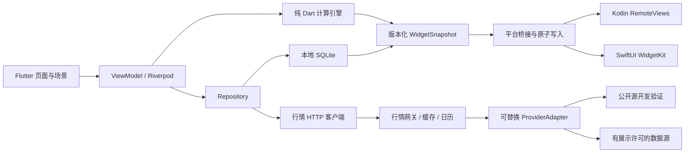

> 范围变更（2026-11-05）：iOS 已移出当前交付范围，发布只产出 Android APK；本文中 iOS/WidgetKit/TestFlight 段落仅保留历史设计参考。

# 技术架构设计

版本 0.2 · 调研日期 2026-11-04。

## 1. 架构决策

采用 Flutter + Dart 实现 Android、iOS 的界面和共享计算。工程采用按功能组织的 View/ViewModel、Repository、Service 分层，独立领域计算包承载计薪、费用分摊及盈亏。依赖方向为 UI → 领域/仓库接口 → 数据实现。Flutter 官方也提供了这一分层结构的指导，可按项目规模简化实现。[Flutter 架构指南](https://docs.flutter.dev/app-architecture/guide)

Android 优先实现与调试。iOS 在 GitHub Actions 的 macOS runner 构建、运行模拟器测试、签名并上传 TestFlight。iOS 构建需要 macOS 与 Xcode，可将所需环境放到 CI。[Flutter iOS 发布文档](https://docs.flutter.dev/deployment/ios)

工程默认 Android API 26 起、iOS 16 起。建项时选择并锁定经过实际构建的 Flutter stable patch、Dart、Xcode、JDK、Gradle、Kotlin、Swift 与 CocoaPods 版本，形成 `toolchain.lock.json` 和依赖锁文件。仓库初始化任务负责验证版本组合，不能仅填 `latest`。

## 2. 总体结构



工资、持仓数量、成本、房租和贷款属于本地账本。行情网关仅接受标的 ID 和查询参数。网关返回公开价格、证券基础信息、日历与数据质量状态，服务端不保存用户财务账户。

## 3. 工程结构与依赖

```text
apps/mobile/
  lib/app/                    # 启动、路由、主题、依赖装配
  lib/features/onboarding/    # 引导、草稿、原子提交
  lib/features/dashboard/     # 统计视图、办公室动画
  lib/features/assets/        # 多持仓与报价
  lib/features/expenses/      # 住房方案、车贷、月账单
  lib/features/widgets/       # 快照生产与配置界面
  lib/features/settings/
  lib/data/                   # SQLite、行情客户端、迁移
  android/                    # Kotlin 小部件与桥接
  ios/                        # Runner、WidgetExtension、桥接
packages/finance_core/         # 纯 Dart 领域与计算
services/market_gateway/       # Python FastAPI 网关和 ProviderAdapter
contracts/                    # API 与平台快照
fixtures/                     # 固定时钟验收数据
prototype/                    # 交互和视觉参照
docs/
```

技术默认选型为 Riverpod 管理状态和依赖、go_router 管理路由、Drift 管理 SQLite、Dio 管理 HTTP、decimal 处理十进制、timezone 处理统计时区。具体版本在 M0 进行兼容性验证后锁定。首版原生桥采用项目自有 MethodChannel，Kotlin 与 Swift 原生持久化快照，减少小部件插件跨版本耦合。

行情网关采用 Python + FastAPI，方便验证 AKShare 候选。单实例初期采用有界内存缓存、每标的 single-flight 和限速，后续多实例共享缓存可迁至 Redis。无需为首版个人账本引入用户服务、交易服务或复杂消息队列。

## 4. 客户端关键数据流

### 启动

1. 打开 SQLite，事务化迁移，读配置与最近快照。
2. 有完整配置进入首页，无完整配置恢复 onboarding draft。
3. 本地引擎立即计算工资和支出。报价缓存按来源时间决定可用或陈旧。
4. 前台启动单个报价刷新会话，按标的批量获取。
5. 合法响应按请求代次和数据时间合并，原子提交行情缓存。
6. 生成新账本版本和小部件快照，异步桥接失败进入重试队列。

### 数字与价格时钟

前台用约 250ms 的 UI tick 请求计算视图，依据 `Clock.now()` 和计薪区间求交，禁止每次 tick 累加工资。系统改时、恢复前台、跨日、时区配置变化时立即重新计算。行情按接入能力默认每 15秒一次批量请求，服务可返回更慢的 `refreshAfterSeconds`。行情变化与动画帧互不驱动。

网络请求在切后台后取消或收尾缓存。轮询使用互斥会话，页面切换保持同一 Repository。后台更新由平台机制调度，恢复时计算补齐，不补播全部动画。

### 本地事务与失败恢复

引导草稿与正式配置分表。最终提交包含 setupSessionId 唯一键，事务内生成设置版本、持仓和账单版本，再设置完成时间。旧配置编辑携带 expectedRevision，冲突提示重新加载。

删除、隐私修改、切换账本模式同时提升 `ledgerRevision`。小部件快照携带该版本，原生端拒绝较旧版本，防止慢请求覆盖隐私状态。清空完成时写更高修订的 tombstone 快照，所有待返回任务校验删除代次。

## 5. 领域引擎与数据存储

`finance_core` 只接收不可变领域对象、报价集合、显式时区和时钟，不访问 UI、数据库或 HTTP。返回 `DashboardSnapshot`，包含金额、组成、计算完整性、版本与来源时间。

SQLite 表包括 app_settings、salary_versions、schedule_versions、schedule_day_overrides、holding_versions、housing_plan_versions、monthly_bills、quote_cache、onboarding_drafts、widget_publish_jobs。时间戳以 UTC 存储，业务日期单独存储统计时区日期。

版本区间用 `[effectiveFrom, effectiveTo)`，同类实体区间禁止重叠。房贷与房租在同一 housing_plan_version 中互斥。金额在 SQLite 用规范十进制字符串或明确比例整数存储，领域计算用 Decimal。跨语言 JSON 金额和数量均为字符串。

数据库迁移按 schemaVersion 顺序执行并测试旧样本。V1 旧房贷配置迁移为 housingMode=mortgage，旧字段保留迁移记录。存在旧资料而缺 onboarding 标志时验证其完整性，完整则生成完成标志，不强制用户重录。

## 6. 行情供应与免密钥方案

### 调研结论

存在免密钥调用的公开数据读取候选。AKShare 项目文档提供东方财富相关 A股行情接口及上金所 `spot_quotations_sge(symbol="Au99.99")`，示例无 token 参数。它们适合做 ProviderAdapter 的接入验证。当前调研仅确认文档与接口形态，尚未在本交付环境实测在线调用。[AKShare 股票文档](https://akshare.akfamily.xyz/data/stock/stock.html)、[AKShare 黄金文档](https://akshare.akfamily.xyz/data/spot/spot.html)

公开访问的技术条件和面向公众 App 的数据展示权需要分别落实。上证信息对 Level-1 行情有专门许可服务，上金所官网也区分延时行情、基准价和行情产品。现有资料不足以确认一套免密钥、免授权且可持续公开分发的完整服务。[上证 Level-1 服务](https://www.sseinfo.com/services/assortment/level1/)、[上金所行情页面](https://www.sge.com.cn/sjzx/mrhq)

### 接入配置

ProviderAdapter 定义 `searchSymbols`、`fetchQuotes`、`getCalendars`、`capabilities`。配置包含来源、是否需 key、数据类型、单位、刷新限制、标的覆盖、许可状态、故障停用开关。

开发环境提供 `fixture`，以及默认停用、可显式开启的 `akshare_public` 验证适配器。若上游拒绝、限流或增加鉴权，直接停用并显示已有缓存状态。公开源的访问前提、频率和允许用途由接入任务记录，避免通过代理轮换等方式绕过访问限制。

生产环境只启用已确认允许当前用途的数据源。开发可在免费候选上推进，真实公开发布需关闭许可与稳定性门禁。用户无需在 App 中填写供应商密钥，供应商密钥由网关部署环境管理。

### 黄金参考定义

优先验证人民币/克的明确参考品种 Au99.99，避免把不同银行积存金、零售首饰金价和回购价混为同一报价。显示品种、单位、参考估值和来源延时。黄金报价的 `tradingDate`、基准价和夜盘归属必须从适配器统一输出。

首次验证先确认上游可提供最新价格、时间、前交易日参考价和交易日归属。若只具备日终数据，响应类型必须为 `eod` 并在 UI 明示。跨数据源基准缺失时允许持有估值，今日变化设为 unknown。各来源价格不得无提示拼接计算今日涨跌。

### 网关策略

- 客户端每请求最多 30 个标的，服务使用共享缓存与 single-flight 合并同标的请求。
- 开放市场目标缓存 15秒，上游能力低于此目标时采用更慢值。休市可缓存至下一个已知会话边界。
- 请求超时目标 5秒，最多一次可重试瞬时失败，指数退避和抖动。429 优先 Retry-After。
- 请求 ID、来源时间、抓取时间、前值、交易日和有效性一起记录。客户端丢弃过期代次和更旧报价。
- 源不可用时返回分项错误或可用缓存，禁止生成随机价格冒充真实行情。
- 网关健康检查区分进程健康与上游健康。提供 `/health` 与受保护的内部状态页面。

## 7. 原生小部件

### 共享数据契约

Flutter 统一生成 `WidgetSnapshotV1`，原生端只消费快照或预计算时间线条目。快照带 schemaVersion、ledgerRevision、createdAt、computedAt、quotesAsOf、privacy、validUntil、完整性、金额字符串、状态及深链。详细字段由 JSON Schema 定义。

隐私开启时所有金额字段从快照中移除，使用 null。原生视图生成的 accessibilityLabel 也使用占位词。更新先写临时文件再原子替换，读取失败回退“打开 App 更新”，防止半写文件。

### Android

采用 Kotlin AppWidgetProvider + RemoteViews，三类初始尺寸，系统可调整大小。后台通过 WorkManager 计划更新，前台保存后、用户手动刷新后直接通知更新。普通 `updatePeriodMillis` 不支持小于 30分钟，WorkManager 周期最小 15分钟且执行时间受系统调度，首版采用 30分钟周期目标。[Android 小部件更新](https://developer.android.com/develop/ui/views/appwidgets/advanced)、[WorkManager 周期任务](https://developer.android.com/develop/background-work/background-tasks/persistent/getting-started/define-work)

原生 Worker 只读取 Flutter 生成的当天确定性预计算条目，选择当前时间之前最近的一条。App 生成未来最多 24小时、5分钟间隔的工资/费用快照，所有投资价格固定为 quotesAsOf 对应值并标记陈旧。若 Worker 没有可用条目，则展示最近快照并保留时间。用户点刷新时可深链 App 请求报价。这样首版只维护一套精确计算引擎。

自定义工资计数不能依赖 Chronometer 自动改变任意金额。首版桌面金额随快照更新，App 内数字持续变化。无需为此常驻前台服务或精确闹钟。

### iOS

采用 SwiftUI WidgetKit extension，通过 App Group 原子共享快照与预计算 TimelineEntry。小部件自己不保存完整工资与持仓账本。App 保存后调用 reload，系统按预算安排时间线和刷新。iOS 对小部件刷新有预算，常见预算随使用情况变化，不能据此保证秒级网络刷新。[Apple 小部件刷新说明](https://developer.apple.com/documentation/widgetkit/keeping-a-widget-up-to-date?changes=la&language=objc)

生成未来条目时工资和费用可依据已知排班计算，投资固定最后有效报价，所有条目保留 quotesAsOf。跨日、月账单缺失或排班未知时截断时间线并提示打开 App。安装扩展、App Group entitlement 和每个 target 的签名需在 CI 校验。App Group 用于主应用与扩展共享数据。[Apple App Group 配置](https://developer.apple.com/documentation/xcode/configuring-app-groups?changes=latest_minor)

## 8. CI、签名和发版

### Pull request CI

Linux 执行格式、静态分析、纯 Dart 计算测试、Flutter 组件测试和 Android debug build。macOS 独立执行 iOS Simulator build 和 Widget extension 编译，测试日期、金额、隐私和深链。每次涉及 iOS target 配置时必须跑 macOS job。

工作流 action 使用已验证的 commit SHA，权限最小化，避免依赖可变标签。锁定 Flutter SDK、Xcode 版本和依赖 lock。缓存 key 包含工具链与锁文件摘要。

### Android release

tag 或显式 workflow_dispatch 触发。从 Secrets 解码 keystore 到 runner 临时目录，构建签名 APK 与 AAB，上传产物和符号。keystore、密码与签名配置不进入仓库。版本号来自发布 tag，构建号单调递增并在触发前校验。

### iOS release

发布默认上传 TestFlight，商店正式发布采用独立受保护步骤。macOS runner 检查 Xcode，安装锁定依赖，恢复 CocoaPods，导入临时 keychain、distribution certificate，以及 Runner 和 WidgetExtension 各自的 provisioning profile。执行 `flutter build ipa`，exportOptions 显式映射两个 Bundle ID 与 profile，校验扩展已嵌入及签名正确，再上传 App Store Connect。

证书、profile 和密码可按 GitHub 官方流程通过 Secrets 安装到 runner，清理阶段使用 always 条件删除临时 keychain 及证书文件。[GitHub Xcode 签名文档](https://docs.github.com/en/actions/how-tos/deploy/deploy-to-third-party-platforms/sign-xcode-applications)

必需配置包括 Apple Team ID、App Bundle ID、Widget Bundle ID、App Group ID、distribution certificate/P12 password、两个 profile、App Store Connect API key ID/issuer ID/private key。首次生成证书可在 macOS CI 上创建 CSR 并通过 Apple 开发者门户签发，整个初始化流程需落实到受保护手动任务，用户本地无需搭建 Xcode。

Secrets 不具备时 PR 编译与本地 Android 开发仍可推进，签名发布任务明确显示缺少配置。CI 成功需与 iPhone TestFlight 真机验证分开记录，重点验证安装、扩展加载、大字、刷新与深链；应用固定浅色。

## 9. 安全与运维

账本存应用沙盒，敏感值不进日志与网关。API 使用 HTTPS、输入长度与标的白名单、速率限制和请求去重。供应商 token 存部署 Secret。移动客户端内静态 token 仅作应用标识，网关不能把它当作秘密认证凭据。

日志默认记录 requestId、symbolId、source、状态码、耗时和数据时间。异常上报默认关闭财务字段。数据库、备份及系统云备份策略应在实现时明确告知用户，首版可禁用敏感数据库的自动云备份。

指标包括报价成功率、过期比例、前台帧耗时、快照发布成功率、引导提交成功率与崩溃率。故障恢复优先保持本地计算和已有时间标记数据可读。

## 10. 开工门禁与发布门禁

M0 完成工具链实构建、领域测试入口与契约校验，即可开展功能开发。上线前另行要求真实数据源验证、公开展示许可结论、包标识、签名和真机验收。未经验证的公开接口在文档中保持候选状态，避免将免密钥访问误写成完整生产服务承诺。
