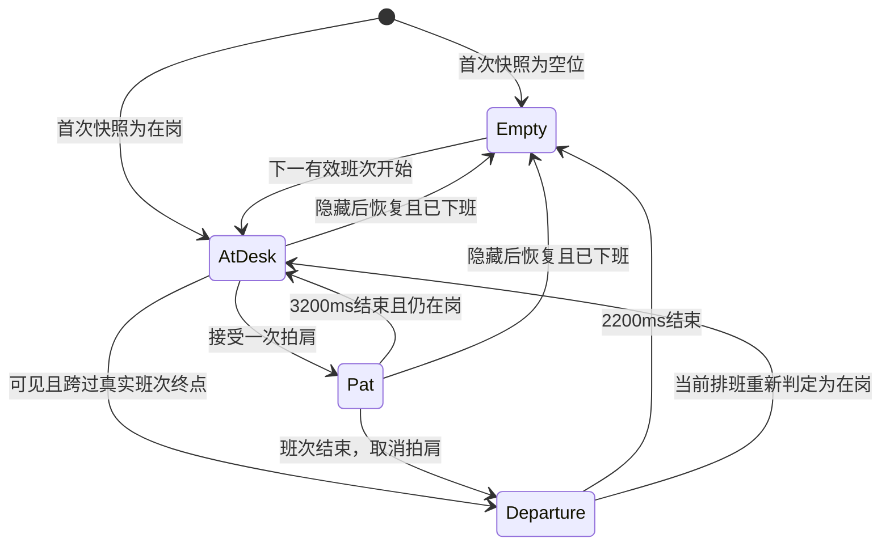

# 拍拍他与下班离场 · 可执行设计方案

版本 1.0 · 2026-11-05 · 状态为设计交付，待实施。

本方案依据当前 Android 工程编写。本次交付为设计文档。以下新增类型、文件、接口、图片和测试名称均为后续实施规格。

## 1. 用户确认与本方案默认决策

用户要求增强“拍拍他”的可感知反馈，下班以后人物离开工位，并将方案细化到其他 agent 能执行开发。

本方案将“拍拍他”设计为一次 3.2 秒的拍肩、抬头、放松和回应。人物在工作与午休时可以被拍。离场设计为 2.2 秒的停手、收拾、起身、走出画面，最终呈现空工位。下班后首次打开直接呈现空工位。

下班、上班前、休息日和排班未知时，按钮显示对应状态并禁用。当前版本选用“人在工位时才能拍”的交互规则，用户无需额外配置。用两个轻微拍肩动作表达安慰，沿用现有主角的乱发、黑眼圈、歪领带和扁平粗线条。

## 2. 已核实的现状与问题

| 位置 | 当前行为 | 设计影响 |
| --- | --- | --- |
| `dashboard_page.dart` 的 `_comfortWorker` | `_comfort=true`，5秒后设回 false，连点重新计时 | 动作缺少阶段，难以感知一次完整回应 |
| `_Body` 创建 OfficeScene | `phase: comfort ? DayPhase.working : snapshot.phase` | 拍人临时覆盖真实工作阶段，休息时也可能回到敲键盘 |
| `office_scene.dart` 的 `_OfficePainter.paint` | `happy = comfort || mood == gain` | 盈利状态已经是笑眼，点击前后表情差别小 |
| `_OfficePainter` 人物分支 | 仅 restDay 不绘人物 | afterShift 和 beforeShift 仍有人坐着 |
| OfficeScene 的 GestureDetector | 整幅场景点击触发 onComfort | 点房子、车和空白也会拍到人 |
| `_quoteLine` | comfort 优先覆盖主卡文案 | 安慰反馈占用了财务状态说明位置 |
| `AppShell` | IndexedStack 保留各页 | 切页后仍需明确处理动画和计时器生命周期 |
| `WidgetSnapshotBuilder.sceneFor` | beforeShift、afterShift 都映射 offDuty | 既有快照枚举足以表达空位 |
| Android 大号小部件 | XML 固定 `@drawable/office_static` | 即使快照 offDuty，静态图仍可能是有人办公 |
| `ScheduleExpander.dayTimeline` | 计薪区间按自然日裁剪，间隔归为 unpaidWindows | 跨夜班需要使用完整班次判断真正离场时间，不能拿午夜裁剪点当下班 |

最后一项是源码结构揭示的边界风险。实施时必须用跨夜、多段班次用例验证，再通过共用排班查询解决，避免界面与倒计时对同一时间给出不同结论。

## 3. 体验原则与状态组成

人物在场与否由实际排班决定。盈亏决定表情和窗外天气。拍肩是短暂的社交回应，离场是班次结束后的过渡。这四类输入分别维护，通过统一展示状态组合。

财务数值、计薪时段、费用分摊、报价刷新继续使用原有引擎。拍肩期间用户在计薪区间内，工资按时间继续增长，敲键盘的画面短暂停一下。拍肩产生的符号使用小短线和腮红，避免被理解为新增收入。

点击拍肩本身不写数据库、不提升ledgerRevision、不请求行情，也不发布小部件快照。瞬态控制器拥有动画epoch，每次取消或启动新瞬态递增epoch，旧完成回调仅在epoch仍匹配时生效。

一次交互应在 120ms 内出现视觉响应。人物正在盈利微笑、金额不完整、午休和低动效模式都要有可识别的反馈。主卡错误提示及报价状态始终可以阅读。

### 3.1 展示状态矩阵

| 工作上下文 | 人物 | 基础姿态 | 拍拍按钮 | 主按钮语义 |
| --- | --- | --- | --- | --- |
| working | 在场 | 敲键盘、疲惫或轻微微笑 | 可用 | 拍拍他 |
| breakTime | 在场 | 手离键盘，靠椅或端杯 | 可用 | 拍拍他 |
| beforeShift | 空位 | 显示椅子、待机屏 | 禁用 | 还没到工位 |
| afterShift | 空位或正在离场 | 收拾后空椅子、休眠屏 | 禁用 | 他已下班 |
| restDay | 空位 | 椅子和休息便签 | 禁用 | 今天不在岗 |
| unknown | 空位 | 配置待确认便签 | 禁用 | 排班待确认 |

报价缺失与排班未知是两种不同情况。排班有效且正在工作时，即便报价不完整也能拍。报价不完整只改变行情状态和天气，不将有效班次判为 unknown。

## 4. 拍拍他 · 触发与布局

### PAT-01 入口

入口一为现有倒计时右侧按钮。有效触控区至少 44×44dp，默认文案“拍拍他”，手掌图标维持现有大小量级。屏幕阅读器读作“拍拍他，给正在工位上的他一点安慰”。

入口二为人物头肩区域。以场景逻辑坐标 380×238 为参照，交互区域为 `Rect.fromLTWH(138, 44, 83, 125)`，布局后用实际绘制比例换算。区域覆盖头部和肩膀，房子、汽车、显示器与地面点击各自保持原交互归属。

两个入口调用同一个 `requestPat()`。触发前读取最新工作上下文及当前时钟，确认人在场、页面可见、App 前台、当前没有 transient 动画。下班边界附近即使页面旧帧仍画着人，也按最新有效班次终点拒绝拍肩。

### PAT-02 反馈区域

场景维持现有 380×238 逻辑坐标。场景下现有单行说明升级为固定预留的反馈区。平常显示状态说明，拍肩时显示带小尖角的纸片对话框。

- 反馈区左右与场景对齐，正文13sp，行距约1.5，内边距8dp。
- 正常字体下预留最少56dp，允许两行。大字体下按 `max(56, 13 × textScale × 1.5 × 2 + 16)` 预留最小高度，并允许内容继续增高。
- 普通说明与回应使用同一个预留区，交互开始时不推动倒计时和金额分项上下跳动。
- 对话框用 panel 底、ink 1.5dp 轮廓，左侧或下侧小尖角指向人物。文字由 Flutter Text 绘制，支持换行与辅助功能。
- 主卡仍展示财务状态。安慰文案只出现在这个反馈区。

### PAT-03 一次点击的时序

总时长3200ms，以接受点击时刻为 t=0。动画时间使用单调时间或 AnimationController，业务时钟仅用于判断是否到了下班点。

| 时间 | 人物与手掌 | 按钮与文字 | 确认点 |
| --- | --- | --- | --- |
| 0—120ms | 手指离键盘，右上方出现简笔手掌 | 按钮显示“收到啦”，禁用；反馈区先显示“他抬头看了你一眼。” | 点击后120ms内必有变化 |
| 120—300ms | 第一拍拍肩，头肩轻轻下沉后回弹 | 同上 | 第一次接触峰值约210ms |
| 300—520ms | 第二拍拍肩，幅度略小 | 对话文字在420ms切换为本次完整回应 | 第二次接触峰值约410ms |
| 520—900ms | 手掌退开，人物抬眼，眉毛松开，出现一点腮红 | 按钮显示“他缓过来一点了”，保持禁用 | 盈利状态也必须看到抬眼、腮红和肩膀变化 |
| 900—2400ms | 肩膀放松，嘴角小幅抬起，保持回应 | 对话框保持，正常读取 | 至少1500ms稳定阅读时间 |
| 2400—3200ms | 恢复当前阶段对应姿态，腮红淡出 | 回应保留到结束，随后回普通说明 | 不跳回点击前缓存的旧盈亏状态 |
| 3200ms后 | 回归 working 或 breakTime 的基础动作 | 按钮恢复“拍拍他” | 接受下一次点击 |

工作期间工资硬币仍按基础状态运行，拍肩手掌和腮红作为独立图层。暂停敲键盘的时间为0—2400ms，2400ms起恢复。午休时手臂只做回应，保持休息姿态。

### PAT-04 关键帧绘制规格

沿用现有头中心约 `(178,96)`、下巴/颈部约 `(178,129)`。角色部件绘制需可分别变换头部、躯干、手臂和表情。

| 部件 | 参数 |
| --- | --- |
| 手掌造型 | 三个圆头短指、掌心与短腕，panel 填色、ink 约2dp轮廓，大小约23×28逻辑像素 |
| 手掌入场 | 掌心从 `(235,106)` 移到 `(210,132)`，平滑减速；指尖落在约 `(200,136)` 的右肩外缘，避开眼睛和嘴 |
| 两次接触 | 210ms、410ms，头部各下沉2.5、1.7逻辑像素，颈部为轴旋转最多2.5° |
| 回弹 | 头部最大压缩比例 Y=0.965，恢复到1.0；没有夸张的身体抖动 |
| 抚拍短线 | 接触点外侧各两笔，长4—6逻辑像素，出现不超过120ms |
| 表情 | 520ms后眼睛由横线转成抬眼/小弧线，眉头松开，嘴角上扬，脸颊各两笔 rose 色腮红 |
| 肩膀 | 520—900ms下落2逻辑像素，手臂自然放松；盈利时也必须保留此变化 |
| 手掌退场 | 520—720ms向右上原路径离开，淡出与位移同时完成 |

接触用平滑的 easeInOut，回弹允许轻微 easeOutBack，最大过冲不超过头部位移的15%。所有路径确定性计算，同一次进度输入得到同一帧。

人物、手掌、房车维持现有纸感浅色与粗轮廓。对话框最高绘制优先级在场景外部。场景内部顺序为背景、房车符号、工位、人物、拍肩手掌及短线。

工作区当前的房车可见性由showHousing/showCar参数控制。场景和静态素材按这两个参数绘制，收入硬币只指向已显示的对应元素。拍肩和离场图层复用相同可见性输入。

### PAT-05 文案池

acceptedPatCount 从本次页面可见会话的0开始，按索引循环。每次成功接受触发后加1，数字刷新或未接受连点不推进文案。文案不依赖随机数。

| 场景 | 温柔地丧 | 再狠一点 |
| --- | --- | --- |
| 工作，第一条 | 辛苦了。你又不是打印机。 | 工资没加，倒是被当人看了一眼。 |
| 工作，第二条 | 收到，肩膀先放下来一点。 | 老板没看见，先松口气。 |
| 工作，第三条 | 谢谢，刚才差点卡成工位配件。 | 牛马收到一点人类关怀。 |
| 午休，第一条 | 先歇会儿，下午再慢慢来。 | 午休被记得，也算公司福利之外了。 |
| 午休，第二条 | 这口气，总算顺下来了。 | 人在充电，账单也在充电。 |
| 午休，第三条 | 有人在意，午休都松一点。 | 打工暂停，做人继续。 |

无对应 tone 时回退温柔文案。拍肩期间选择语气或报价更新，当前一句读完，下一次采用新语气。金额不完整仍保留主卡说明，反馈不遮挡具体缺失项。

### PAT-06 连点与触觉

- 单次动画播放中忽略后续点击，按钮禁用，头肩入口同样拒绝。
- 不排队、不延长3200ms，不重复创建 Timer，不叠加多个手掌。
- 允许一次被接受点击对应一次轻触觉，遵循 Android 系统触觉设置。动画内两次接触不再分别触发震动。
- 默认无音效。减少动效不会产生新的声音或更强震动。
- 一次交互结束后即可再次拍，首版无需额外冷却计数或连击系统。

## 5. 下班离场 · 时机与稳态

### OUT-01 什么时候离场

以真实有效班次结束时刻为准，使用工资时区、排班版本、日期覆盖和完整班次区间。晚上加班到20:00的配置在20:00离场，22:00—次日02:00的班次在次日02:00离场。

实际可见的首页，在连续前台观察中跨过同一班次结束点，且首次观察到结束的延迟不超过2000ms时播放离场。超过窗口、首次打开、从后台恢复、切回首页、编辑排班或改变示例模式时直接显示对应稳态。

2000ms是设计容错窗口，防止250ms刷新和短暂掉帧错过离场。它只决定是否播放过渡，不延长班次。数值和按钮在真实结束时刻立即使用结束状态。

### OUT-02 离场分镜

总时长2200ms。t=0起新的拍拍请求禁用，正在播放的拍拍结束为 cancelled。工资计薪与当前phase立刻按业务时间更新。

| 时间 | 动作 | 配套状态 |
| --- | --- | --- |
| 0—220ms | 停手，键盘动作停止，移开双手 | 工资硬币在最多180ms内收尾，固定支出数字继续 |
| 220—560ms | 关掉显示器，人物抬头并准备起身 | 行情屏的线图退为一条待机短线 |
| 560—860ms | 从椅子站起来，歪领带晃一下，肩侧出现小包 | 反馈区显示“今日工位，暂停营业。” |
| 860—1900ms | 把椅子推回一点，提包向画面右侧走出 | 腿交替摆动，小幅上下起伏，人物位于工位前景 |
| 1900—2200ms | 人物完全离开，椅子轻轻回正 | 便签改成“已下班”，进入稳定空工位 |

离场不要求新增房间、写实门或第二套场景。右侧画面边缘作为出场边界，离开时的手绘速度线最多两笔。最后一帧必须没有人物、手掌、包或残留腿脚。

### OUT-03 轨迹与图层

- 起身头部中心由 `(178,96)` 到 `(181,80)`，脚尖落点接近原地面 y=212。
- 860ms时角色脚底基线固定在y=212，以统一角色根节点做横移，x中心从181到420。
- 走路腿摆幅不超过12°，躯干摆幅不超过3°，头部上下位移不超过1.5逻辑像素，步频约2.5Hz。
- 小包约14×18逻辑像素，采用rose/panel色块，挎在身体侧后方，与现有领带和椅子保持同一线宽。
- 桌后坐姿按现有遮挡绘制。进入行走段后角色整体绘制在桌子前景，避免腿被桌面错误裁断。
- 房子和小车是账单示意图层。行走角色经过时位于它们前景，绘制自然遮挡即可。
- 图层外使用场景边界裁剪。x达到420后不再绘角色，杜绝下一帧循环回到原工位。

### OUT-04 空工位终态

空椅子保留，向桌侧偏约6°，显示器处于待机状态，便签写“已下班”。马克杯无持续新热气，工资硬币停止。窗外保留已有盈亏天气，但天气不会召回人物。

状态标签优先“他已下班”。反馈区按实际固定支出选择文案。

| 数据条件 | 文案 |
| --- | --- |
| 已知且有正固定支出 | 人下班了，固定支出还在全勤。 |
| 已知固定支出为0 | 人已下班，今天到此为止。 |
| 固定支出金额未知 | 人已下班，账单明细待更新。 |

住房选择房租时使用“房租”或“固定支出”。人物离场行为与是否有车贷、股票、黄金无关联。

### OUT-05 上班前与休息日

上班前是空工位，便签“还没到岗”，显示器待机，按钮“还没到工位”。休息日是空工位，便签“今日休息”，按钮“今天不在岗”。排班未知时便签“排班待确认”，按钮“排班待确认”。

当下一班真正开始，直接切到在岗基础姿态，使用最多200ms的轻淡入即可。当前范围只规定下班离场，不增加到岗长动画。午夜只触发真实班次上下文重算，不强制人物出现或消失。

## 6. 减少动效、触觉与无障碍

### MOTION-01 减少动效

系统或 App 启用减少动效时，拍拍仍提供完整语义反馈。一次点击立即切到抬眼、腮红和放松肩膀的静态关键帧，对话框保留2400ms，再切回最新基础帧。手掌摆动、头部压缩、弹跳和速度线关闭。

下班时立即切空工位，不播放2.2秒离场。反馈区同样显示下班文案。用户在拍拍中途打开减少动效时，取消运动，以当前接受时间为起点保留静态回应至2400ms，已超过2400ms则结束。离场中途打开减少动效时直接完成离场。

### A11Y-01 无障碍

- 一次接受的拍肩通过一个 live region 播报本次回应，不逐帧播报。
- Button disabled 状态和“他已下班”等原因清晰可读。禁用按钮无需接收点击才解释原因。
- 场景 Semantics 随状态描述“在工位上”“午休中”“人物正在离场”“空工位，人物已下班”，与画面一致。
- 头肩触控入口使用一个语义按钮，避免 GestureDetector 与父 Semantics 导致重复播报。外部按钮保留独立入口。
- 对话框至少与原正文同等对比度，无闪烁和快速明暗交替。字体200%时可换行、可增高，正文不裁切。
- 下班事件仅播报一次“他已下班，工位已空”，不因每次快照重算再次播报。

## 7. 状态、竞态和生命周期契约

### 7.1 只读工作上下文

展示层需要完整班次上下文。现有 DayTimeline 继续提供自然日计薪进度，补充一个由排班查询得到的只读上下文，用于人物、倒计时和场景快照共用。

```dart
// 设计接口，具体命名可遵循现有代码风格。
final class WorkSessionInfo {
  final String key; // 排班版本 + shiftDate + 完整起止UTC，跨自然日保持稳定
  final DateTime startUtc;
  final DateTime endUtc;
  final List<PaidSegment> paidSegments;
}

final class WorkSessionContext {
  final DayPhase phase;
  final WorkSessionInfo? activeSession;
  final WorkSessionInfo? lastEndedSession;
  final WorkSessionInfo? nextSession;
  final bool scheduleValid;
}
```

复用 ScheduleExpander 对版本、日期覆盖及时间区间的解释，抽出共用的完整班次查询。工作班次按原始 shiftDate 的时间段组成，班次结束取其最后一个有效区间终点，午休为同一班次中间的非计薪间隔。整段查询不按午夜裁断，金额计算仍按原有自然日/月边界裁剪。

DashboardSnapshot 增加可派生的工作上下文供消费者读取。它是运行时结果，不进入数据库或持仓数据。原有构造入口可以默认空上下文，生产计算入口必须填充，相关固定测试构造同步补齐。

phase判定顺序为以下步骤。

1. 配置缺失或无效为 unknown。
2. 当前时刻在完整班次区间内，落在计薪段为 working，其余为 breakTime。
3. 当前不在班次内、且本统计日有真实结束的班次，为 afterShift。
4. 否则本统计日有未来开始的班次，为 beforeShift。
5. 否则为 restDay。

班次区间采用 `[start,end)`。午夜仍处于跨夜班时适用步骤2。夜班02:00结束、当天22:00又有下一班时，02:00至22:00人物为空位，可显示“已下班，下一班22:00”。倒计时使用完整班次的endUtc，避免在午夜提前显示下班。

完整班次查询至少覆盖可能延续到当前时刻的前一班、今天和下一班。实现时依据现有合法班次最大跨日范围展开，不能假定所有班次在当天结束。大小周及日期覆盖沿用现有模板选择。

### 7.2 展示模型

```dart
enum Presence { atDesk, emptyDesk }
enum TransientKind { idle, pat, departure }

final class ScenePresentation {
  final DayPhase phase;
  final Presence presence;
  final SceneMood mood;
  final TransientKind transient;
  final double progress; // 0..1，对应当前瞬态的完整时长
  final bool canPat;
  final String? responseId;
}
```

Presence在working/breakTime为atDesk，其余为空位。离场过渡时逻辑Presence已为空位，渲染器允许在departure内绘制正在离开的角色。点击门控读取逻辑Presence，因此离场角色不可继续被拍。

优先级从高到低为页面/配置失效、下班离场、有效拍拍、基础姿态。mood为独立输入，报价改变仅更新它，不重置transient.progress。



### 7.3 控制器所有权

建议新增 `SceneInteractionController` 统一拥有拍肩与离场两个一次性AnimationController，互斥运行，并暴露一个Listenable及不可变ScenePresentation。DashboardPage负责传入工作上下文、真实可见性、低动效、当前语气和namespace。

OfficeScene原有8秒环境循环控制器继续负责雨、呼吸、基础敲键盘。人物瞬态从外部controller读取，避免同时拥有旧5秒Timer和新瞬态时钟。按控制器实际数量选择TickerProvider mixin。

用Provider监听或明确的状态绑定驱动reconcile。初次快照只设置静态状态，避免在build内触发notifyListeners。250ms财务tick不会重新创建控制器或按键会话。

```text
requestPat(nowUtc)
  读取当前完整班次与页面状态
  若不可拍，返回 rejected，所有计时与文案索引保持
  捕获 responseId，启动 pat，返回 accepted

reconcile(context, nowUtc)
  首次/数据身份改变/排班修订改变/时钟跳变 → 取消瞬态并取当前稳态
  前台可见且连续跨越同一班次终点 → 取消 pat，启动 departure
  不可见 → 取消瞬态，停止环境循环
  其他更新 → 保留有效瞬态进度，更新 mood 与当前上下文
```

### 7.4 可见性

`sceneVisible`需要同时满足App处于resumed、首页被选中、首页未被设置等路由覆盖、场景在滚动视口内可见。场景可见面积超过50%时视为可见。滚动、页面切换和前后台变化时重算。

若现有工程暂无可见性工具，可用ScrollNotification和post-frame测量场景与视口交集，无需为了此需求引入整套状态管理依赖。隐藏时取消拍拍和离场，不后台排队。重新可见立即显示最新稳态。

### 7.5 明确的边界行为

| 事件 | 结果 |
| --- | --- |
| 拍拍第1.5秒到下班点 | 取消拍拍，马上禁用按钮，开始离场 |
| 离场中报价从亏转盈 | 人物继续离开，只更新天气/数值 |
| 离场中编辑排班延长工作时间 | 取消离场，直接恢复新上下文的在岗基础帧 |
| 拍拍中午休结束 | 延续剩余回应，结束后恢复working姿态 |
| 拍拍中切页或App后台 | 取消瞬态，停止相关ticker，返回时不补播 |
| 离场过程中切后台，再回来 | 若已下班，显示空位；若新班已开始，显示在岗 |
| 从设置返回已过下班点 | 空位，不补播离场 |
| 切入/退出示例模式 | 清空瞬态，按新namespace的快照稳态展示 |
| 修改系统时钟或更换排班/账本版本 | 取消瞬态，重新求当前工作上下文，避免把时间跳变当实时离场 |
| 午夜跨日但班次还没结束 | 人物仍在岗，不触发离场 |
| 首页加载失败或配置被清空 | 取消瞬态，显示unknown或上层加载/错误组件 |
| 中途减少动效 | 按第6节选择静态回应或空位 |

离场去重只需当前可见会话内的lastDepartureSessionKey。刷新同一个结束快照不会再次播放。控制器销毁后不保存动画进度到数据库，再次打开直接展示稳态。

## 8. 小部件与其他入口的一致性

### WSC-01 大号小部件

Android原生大号小部件按已有`scene`选择静态图。

| 快照scene | 图片 | 人物 |
| --- | --- | --- |
| working | 现有office_static或新office_working | 坐姿静态 |
| break | office_break | 午休静态 |
| offDuty | office_empty | 空位 |
| restDay | office_empty | 空位 |
| unknown/无快照/tombstone | office_empty | 空位，外部文字说明状态 |

`FjobWidgetProvider.bind`每次渲染显式setImageViewResource，避免XML默认图或复用RemoteViews残留上一次的人物。图片不烘焙金额、用户名和拍肩回应，scene与caption来自当前快照。

静态图还需匹配房车可见性。用`visibilityKey = (showHousing ? 1 : 0) | (showCar ? 2 : 0)`生成00、01、10、11四种组合。三个场景模式working/break/empty各有四种组合，共12张，由同一Painter批量生成。

共享快照复用住房/车贷可见性字段。若接入时仍缺字段，SCN-04在V1中增加可选boolean字段showHousing/showCar，生成端分别取住房与车贷的配置状态，解析旧快照缺字段时默认true以兼容旧显示。同步更新JSON Schema、Kotlin解析、固定样例及测试。金额为0与项目未配置需要分别表达，可见性不直接通过金额正负判断。若其他任务已补齐等价字段，先对齐现有契约再接入，避免并行产生两套字段。

`WidgetSnapshotBuilder.sceneFor`使用当前字符串枚举，beforeShift与afterShift都对应offDuty。它从修正后的工作上下文派生，拍拍、起身和走路只作为App内瞬态。

App内大号预览同样采用当前稳态并关闭transient，预览和原生静态图在是否有人这一点保持一致。Widget系统更新时间可能晚于下班点，展示其真实快照时间，下一次有效渲染必须选择空位图。

### WSC-02 引导与示例

欢迎页现有办公室是解释产品的静态工作场景，不展示拍拍按钮。其绘制模式显式指定为illustration，不订阅真实离场事件。交互示例首页服从示例固定时钟，点击拍拍可播放完整回应。离场自动化验收使用可推进的测试Clock，不依赖真实等到下班。

## 9. 资产与绘制清单

| 素材/部件 | 绘制要求 | 使用位置 |
| --- | --- | --- |
| 抬眼/放松表情 | 与现有脸型、乱发、眼袋一致，腮红两笔 | PAT关键帧 |
| 手掌 | 3指简笔轮廓，23×28逻辑像素 | 拍肩前景 |
| 接触短线 | 每次最多两笔，避免金币/积分符号 | 拍肩前景 |
| 小包 | 14×18，低饱和纸色/rose，短背带 | 离场人物 |
| 空椅子 | 沿用椅子，可偏转6° | 空工位 |
| 待机显示器 | 原有屏幕，soft填色和一条短线 | 下班/空位 |
| 便签状态 | 已下班/还没到岗/今日休息/排班待确认 | 空工位 |
| office_break.png | 同一Painter离屏生成 | Android大号小部件 |
| office_empty.png | 同一Painter离屏生成 | Android大号小部件 |

PNG表中的名字表示场景资源族，实际输出按第8节追加房车可见性后缀，例如office_empty_00、office_empty_11。

优先延续CustomPainter绘制，角色分部件后复用现有轮廓。房和车继续调用DebtArtPainter。素材输出用已有generate_office_art工具扩展为按模式生成，避免手绘两套有差异的办公室。

## 10. 开发任务拆解

各任务完成后附文件清单、测试命令、关键帧截图、需求编号和未完成项。任务编号为本方案局部编号。

### SCN-01 完整班次与人物存在性

输入为第3、5、7节。

主要文件包括`packages/finance_core/lib/src/schedule/schedule_expander.dart`、`packages/finance_core/lib/src/dashboard/dashboard_calculator.dart`及现有领域导出文件。为自然日计薪时间线补齐只读完整班次查询和WorkSessionContext，复用模板、大小周、日期覆盖与有效版本规则。

完成条件为09:00—18:00、午休、22:00—次日02:00、夜班结束后当晚再开班、跨月、大小周、休息覆盖均能正确判断人物是否在场。现有工资/费用fixture结果一致。实现不得依赖固定18:00。

### SCN-02 拍肩控制器与反馈

新增建议文件`apps/mobile/lib/features/dashboard/scene_interaction_controller.dart`，修改`dashboard_page.dart`与`office_scene.dart`。

实施第4、6、7节，删除页面旧5秒comfort Timer与phase强制working路径。把主卡的安慰文案移到预留反馈区。按钮和头肩触控共用requestPat，实现3.2秒互斥时序、静态低动效和单次触觉。

完成条件为第一次点击120ms内响应，盈利笑脸也有明显差异，连点不叠加，不把休息角色召回，不因金额刷新重新开播。

### SCN-03 角色分层与离场

修改OfficeScene绘制。可将角色绘制抽到`worker_painter.dart`，让头、躯干、四肢、包和表情可以受ScenePresentation控制。DebtArtPainter保持复用。

实施第5节完整2.2秒动作，首次进入与恢复时直接空位，补齐beforeShift/restDay/unknown空位画面。维护姿态切换和图层遮挡，末帧无人物残影。

### SCN-04 生命周期与静态小部件

检查`app_shell.dart`的IndexedStack、首页路由和滚动可见性，明确isSceneVisible传递。检查`widgets_page.dart`、`data/widget_snapshot.dart`、Android `FjobWidgetProvider.kt`和`widget_large.xml`。扩展`tool/generate_office_art_test.dart`输出break/empty静态图。

完成条件为隐藏页面无瞬态ticker继续运行，后台结束后返回空位，原生大号小部件按scene和房车可见性选图，共享契约及隐私测试通过。接入前检查工作区现有showHousing/showCar改动，基于当前实现合并。

### SCN-05 交互、绘制与回归验收

基于现有`test/support/test_env.dart`固定Clock及截图工具，新增控制器、组件与关键帧截图测试。先测确定性状态与时序，再检查人工截图。建议测试名为`scene_interaction_controller_test.dart`、`office_scene_test.dart`和`dashboard_scene_test.dart`，文件名可遵循仓库风格。

按第11节矩阵交付验收结果。涉及周期环境动画的测试使用明确pump时长，不用无限pumpAndSettle等待循环结束。

## 11. 验收矩阵

| ID | 输入/操作 | 预期 |
| --- | --- | --- |
| PAT-T01 | working、亏损，点按钮 | 120ms内回应，3200ms结束，见手掌、抬眼、腮红 |
| PAT-T02 | working、盈利且原本笑眼 | 与点击前明显不同，动作和回应完整 |
| PAT-T03 | breakTime拍头肩 | 休息姿态回应，工资保持该时刻应有值 |
| PAT-T04 | 点房子、汽车、空白 | 不触发拍肩，文案索引不变 |
| PAT-T05 | 1秒内点击20次 | 仅接受1次，仅一次触觉，原时长不延长 |
| PAT-T06 | 第3200ms后再点 | 接受第2次，按池取下一句 |
| PAT-T07 | 金额partial但排班有效 | 能拍，主卡缺失状态仍可读 |
| PAT-T08 | 同一FakeClock轨迹，分别有拍/无拍 | 全部金额快照一致，证明动画不改计算 |
| PAT-T09 | 拍拍期间多次报价和tick | 进度持续，不回到0ms |
| PAT-T10 | 减少动效 | 立即静态回应，2400ms后结束，无路径移动 |
| PAT-T11 | 语气中途改变 | 当前句读完，下一次采用新池 |
| PAT-T12 | afterShift/restDay/beforeShift/unknown | 按钮原因正确，按头肩也不召回人物 |
| PAT-T13 | 只执行一次拍拍请求 | 数据库、行情请求及小部件发布均无新增调用，账本修订不变 |
| OUT-T01 | 17:59:59.900至18:00:00.100，同一日班 | 触发一次离场，真实18:00起禁用拍肩 |
| OUT-T02 | 18:00:02.500才第一次观察结束 | 直接空位，避免迟到重演 |
| OUT-T03 | 18:30冷启动 | 第一帧即空位，无走路补播 |
| OUT-T04 | 17:59后台，18:01恢复 | 空位，不补播离场 |
| OUT-T05 | 午夜仍处于22:00—02:00班次 | 保持在岗，倒计时到02:00 |
| OUT-T06 | 次日01:59:59至02:00，晚上22:00另有下一班 | 02:00离场，之后空位直到下一班 |
| OUT-T07 | 11月30日跨12月1日夜班 | 按实际班次结束，午夜金额按原算法分月 |
| OUT-T08 | 大小周休息日/日期覆盖休息 | 空位，拍拍禁用 |
| OUT-T09 | 拍拍第1500ms遇下班 | 拍拍取消，离场开始，最终无手掌/人物残留 |
| OUT-T10 | 离场中修改排班为仍在岗 | 取消离场并回新基础帧，后续旧callback无效 |
| OUT-T11 | 离场时切资产页，再返回 | 返回最新稳态，不重播 |
| OUT-T12 | 离场中盈亏变号 | 人物继续离开，天气可更新 |
| OUT-T13 | 同一个afterShift快照刷新100次 | 离场只播放一次 |
| OUT-T14 | 减少动效遇下班 | 立即空位，保留正确说明 |
| LIFE-T01 | 首页保留在IndexedStack但选别页 | 瞬态取消、相关ticker停用 |
| LIFE-T02 | 滚动至场景不可见后跨下班点 | 返回场景时空位 |
| LIFE-T03 | 设置路由覆盖首页时跨下班点 | 返回空位，无隐藏动画补播 |
| LIFE-T04 | 拍拍或离场中切示例/正式账本 | 取消旧瞬态，显示新上下文 |
| LIFE-T05 | 系统时钟前跳或后退 | 重新取稳态，旧计时回调无效 |
| WSC-T01 | 原生大号offDuty/restDay/unknown | 均选择空位资源 |
| WSC-T02 | 原生大号由working刷新到offDuty | 旧人物图被显式替换 |
| WSC-T03 | App预览与原生同一scene | 是否有人一致 |
| WSC-T04 | working/break/empty × 房车00/01/10/11 | 12种组合中未配置元素及其硬币路径均不出现 |
| A11Y-T01 | 字体200%、320dp | 对话可读，按钮不挤出屏幕 |
| A11Y-T02 | 屏幕阅读器接受一次拍拍 | 一次回应播报，动态金额不逐帧播报 |
| A11Y-T03 | 空位场景 | 语义描述无“疲惫小人坐在工位” |

### 11.1 必交关键帧

拍肩按0、120、210、410、720、1200、2600、3200ms截图。离场按0、560、860、1400、2200ms截图。另交盈利初始帧、午休回应、下班冷启动、休息日、低动效回应、320dp大字体各一张。

截图使用同一场景大小与固定时钟，标明采样时间。重点核对手掌接触位置、头部表情差异、文字无遮挡、行走遮挡和末帧没有人。

## 12. 给实施agent的任务提示词

```text
实施 docs/09-design-comfort-and-clock-out.md，按 SCN-01 至 SCN-05 逐项完成。

先读取 AGENTS.md 与当前 dashboard_page.dart、office_scene.dart、
DashboardCalculator、ScheduleExpander 和 Android Widget 渲染。
人物在工位时接受拍拍，拍肩3.2秒，下班离场2.2秒，之后为空位。
所有时序、坐标、文案、低动效与生命周期规则以此设计文档为准。

优先复用现有时钟、排班展开、Painter、Provider及测试工具。
把完整班次的阶段与日/月计薪裁剪区间区别落实到共用工作上下文中，
用跨夜测试证明午夜不会误判下班，02:00结束也不会被误当成长午休。
页面旧comfort计时器和强制working路径应迁移到统一瞬态控制器。
验证拍肩前后在相同业务时钟下金额完全一致。

完成后交付需求编号对应结果、修改文件、测试命令、关键帧截图，
以及 Android 大号小部件使用空位资源的验证证据。
```

## 13. 本次设计交付自检

已核对当前按钮回调、phase覆盖、Painter人物分支、自然日时间线、IndexedStack、大号小部件资源和现有测试入口，任务清单指向实际存在的工程文件。

当前文档的时长、坐标、文案池、低动效处理及可见性阈值为本轮补齐的设计默认值。实现后以第11节关键帧和边界矩阵验收，业务效果与性能数据由后续开发验证记录。

## 14. 动画原型附件

本轮已补充[可播放动画原型](../prototype/animation.html)、[可编辑源文件](../prototype/animation-source.html)、[时间轴参数](../prototype/animation-timeline.json)和[13张关键帧](../prototype/animation-keyframes)。完整操作与自动采样接口见[动画交接说明](../prototype/ANIMATION-README.md)。

原型可播放PAT、OUT和拍肩中途下班，支持暂停、精确seek、关键帧定位、半速、午休和空位稳态、低动效、盈亏表情及房车图层。财务金额和排班边界采用审稿用快照与事件预设，实施业务逻辑时仍按本设计第7节的真实工作上下文处理。
