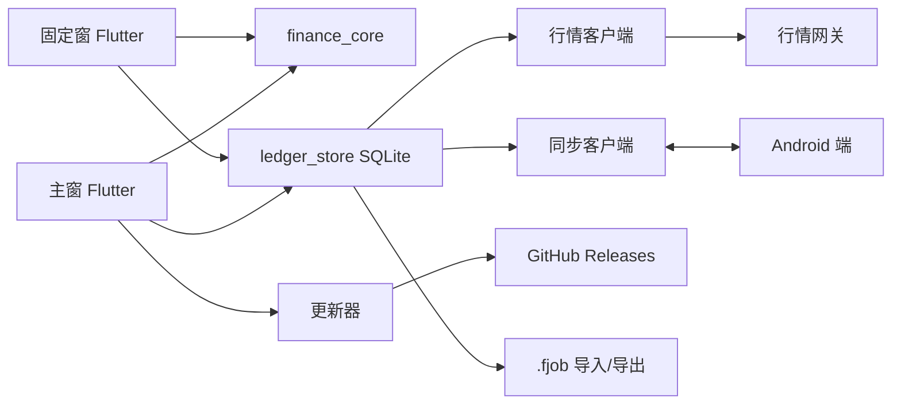

# PC 伴生端设计方案（草案）

版本 1.0 · 2026-11-10 · 状态：**决策已确认；详细设计与实施交接见 `docs/14`、`docs/15`；生产未实施**。关联 `docs/01`、`docs/02`、`docs/04`、`docs/12`、`contracts/widget-snapshot-v2.schema.json` 和 `prototype/index.html`。

本文回答三个问题：PC 端做什么、长什么样、怎么落地。所有金额与时间口径继续以 `docs/04` 和 `docs/12` 为准；本文不另立一套算法。

## 0. 结论先行

1. **方向成立，但 PC 端不应是手机端的缩放版。** 它的不可替代价值是“工位上的余光可见”：不打开 App 也能看到还有多久下班、今天到底白干没有。配置管理是支撑面，不是安装理由。
2. **竞品验证了需求，也暴露了空位。** “实时工资 + 下班倒计时”有大量单点工具，但普遍缺账本、缺排班、缺口径说明、缺多端；Windows 上把工资、排班、资产、房贷车贷和生存结余做在一起的常驻产品几乎空白。
3. **同源账本是最大差异化。** PC 必须复用 `finance_core` 和同一套 `fixtures/calculation-cases.json`，不能另写一套“差不多”的工资计算。否则手机和电脑会给出两个数字，产品信任立刻归零。
4. **推荐 Windows 优先、Flutter 桌面、复用 Dart。** 窗口能力（置顶、穿透、托盘、多屏）用插件加少量 Win32 补齐；不建议为了窗口体验改用 Tauri/Electron 而重写计算内核。
5. **数据同步分阶段。** v1 做本地账本 + `.fjob` 文件导入导出；v1.1 做局域网配对双向同步；云同步暂不做。这样首版可独立验收，又不把“同源”永久押后。
6. **固定窗默认“便签卡”**：无边框、置顶、不抢焦点、右下角、可拖动贴边、可穿透、可一键隐身；核心是下班倒计时，次核心是今日生存结余。三档密度：数字条 / 便签卡 / 工位窗。

需要拍板的决策见第 12 节。

## 1. 竞品调研

检索日期 2026-11-10。下表只列实际打开或搜索确认存在的产品；未确认的能力明确标注。竞品的作用不是抄功能，而是确认“哪些是刚需、哪些是差评源”。

### 1.1 国内产品

| 产品 | 形态 | 核心能力 | 收费 | 可借鉴 | 明显问题 |
| --- | --- | --- | --- | --- | --- |
| [摸鱼时钟](https://narra-data.github.io/moyu/) | Web | 下班倒计时、按月薪实时累计“今日已赚”、B 键伪装报表、本地存储、免登录 | 免费开源 | 老板键与零登录 | 无桌面常驻、无配置沉淀 |
| [实时工资计算器](http://salary.gcc.ac.cn/) | Web | 时薪/时长实时累计、进度条、满百撒币 | 免费开源 | 即时反馈强 | 单次计时玩具，无发薪日/排班 |
| [FishCather](https://github.com/Jiangleling2099/FishCather) | Windows / Python | 下班、发薪日、周末倒计时，喝水提醒，贴边隐藏 | 免费开源 | 贴边隐藏为小图标 | 完成度有限，无工资累计 |
| [每日摸鱼](https://github.com/vv0651234649-spec/Daily-Fish-Log) | Windows / .NET | 透明置顶桌宠、09:00–18:00 进度、ESC 老板键、托盘 | 免费开源 | 桌宠 + 老板键 + 托盘的组合 | 功能杂、堆小游戏、无账本 |
| [摸鱼日历](https://github.com/Price869/moyu-calendar) | Windows / WPF | 年/月/日环进度、发薪日/节假日倒计时、置顶、桌面模式、点击穿透、托盘、自启 | 免费开源 | 穿透、桌面模式、自启的完整度 | 无工资实时、无支出、无同步 |
| [打工人秒表](https://github.com/wh930303/dagongren-miaobiao) | macOS 13+ | 实时计薪、下班倒计时、悬浮窗、发薪日 | 免费开源 | 极简悬浮窗 | 仅 macOS、无支出 |
| [VPet](https://store.steampowered.com/app/1920960/VPet/) | Windows / Steam | 桌宠互动、创意工坊 | 免费 | 角色生态与好评基础 | 娱乐化、易分心，非效率工具 |
| [小黄条](https://www.yynote.cn) | Windows / 移动 | 透明待办、日历、倒计时、天气，可嵌桌面 | 会员 ¥30/季起 | 透明嵌入与多端 | 无 macOS、核心常驻在会员墙后 |
| [敬业签](https://www.jingyeqian.com) | 全平台 | 桌面透明悬浮窗、置顶、嵌入、重复提醒 | 免费 + 会员 | 悬浮与提醒成熟 | 功能重、易打扰、价格不透明 |
| [MyDockFinder](https://store.steampowered.com/app/1787090/MyDockFinder/) | Windows / Steam | 桌面 Dock 与美化 | $4.99 | 证明桌面常驻可付费 | 单人维护、稳定性与更新节奏 |
| [随手记](https://www.sui.com) | Web / 移动 | 记账、预算、多账本、资产 | 免费 + VIP | 账本与预算模型 | 无现代 Windows 客户端 |
| [MoneyWiz](https://www.moneywiz.com) | Apple 平台 | 资产、负债、净资产、预算、账单预测 | 订阅 | 净资产总览与 Privacy Mode | 无 Windows、无常驻 |

### 1.2 海外产品

| 产品 | 形态 | 核心能力 | 收费 | 可借鉴 | 明显问题 |
| --- | --- | --- | --- | --- | --- |
| [Wagebeat 薪跳](https://github.com/Shamnick/Wagebeat) | macOS 13+ | 菜单栏 + 浮动工资条，默认置顶可关，跨 Space/全屏，位置记忆，0.1s 刷新，午休/上下班文案 | 免费开源 | **最接近本方案固定窗的形态参考** | 仅 macOS，无支出/资产 |
| [Salary Glass Clock](https://github.com/GGBond2424648901/salary-glass-clock) | Windows / Electron | 置顶 Pin、0–100% 透明、紧凑条、字号 80–160%、今日/月/时薪 | 免费开源 | 透明小窗的直接手感 | 口径简单，无排班/税/假，易误导 |
| [Toggl Track](https://toggl.com/track/) | Windows / macOS | 计时、Keep on top、全局快捷键、收入报表 | 免费 3 人 | 置顶开关 + 全局热键 | 非实时工资，产品较重 |
| [Clockify](https://clockify.me/) | Win/mac/Linux | 状态栏计时、全局快捷键、空闲检测、番茄钟 | 免费 5 人 | 状态栏常驻 | 常驻展示弱 |
| [RescueTime](https://www.rescuetime.com/) | Windows / macOS | 后台自动记录、专注屏蔽 | $7/月起 | 隐私声明具体（不采集键盘/输入文本） | 不做收入换算 |
| [Shimeji-ee](https://kilkakon.com/shimeji/) | Windows / Java | 角色在桌面行走、可换角色 | 免费 | 角色生态 | 需 Java、配置弱 |
| [Desktop Goose](https://samperson.itch.io/desktop-goose) | Windows / macOS | 覆盖层、抢鼠标、弹窗、Mod API | 按需付费 | 可配置的“轻打扰”边界 | 不可控打扰、多屏会消失、易被误判病毒 |
| [Bongo Cat](https://github.com/ayangweb/BongoCat) | Windows / macOS | 键鼠/手柄联动、可换模型、离线、不收集数据 | 免费开源 | 输入联动 + 隐私口碑 | 置顶/穿透能力未确认 |
| [Desktop Mate](https://store.steampowered.com/app/3301060/Desktop_Mate/) | Windows / macOS | 桌面伴侣、坐窗口、拖拽、闹钟、贴边 | 免费 + $14.99 DLC | 贴边与尺寸 | DLC 过载，近期评价下滑 |
| [Rainmeter](https://www.rainmeter.net/) | Windows | 皮肤化桌面挂件、插件、社区皮肤 | 免费开源 | 皮肤生态与桌面常驻 | 第三方皮肤供应链与权限风险 |
| [Windows 11 Widgets](https://learn.microsoft.com/en-us/windows/apps/develop/widgets/) | Windows | 系统小组件面板、多尺寸、可配置 | 免费 | 系统级 glance | 不是桌面悬浮，曝光依赖面板 |
| [MoneyWiz](https://apps.apple.com/us/app/moneywiz-2027-personal-finance/id1511185140) | Apple 平台 | 资产、负债、预算、账单提醒、Privacy Mode | $29.99/年起 | Privacy Mode 与账单日历 | 无 Windows |
| [Actual Budget](https://github.com/actualbudget/actual) | Win/mac/Linux | 本地优先、自托管同步、E2E | 免费开源 | 本地优先架构 | 同步要自建，门槛高 |
| [Firefly III](https://github.com/firefly-iii/firefly-iii) | 自托管 Web | 复式记账、预算、定期交易、API | 免费开源 | 固定支出模型 | 部署门槛、无原生桌面 |

### 1.3 跨产品结论

1. **真正的钩子是“今天已赚 + 还有多久下班”，不是记账。** 记账是留存后的深度功能；第一眼必须给答案。
2. **常驻礼仪是生死线。** 小、静音、可拖、可缩、可透明、置顶可关、位置记忆、多屏不丢；强制置顶和弹窗轰炸是差评主因。
3. **老板键是刚需，不是彩蛋。** 一键隐藏/伪装/暂停，且恢复路径必须可发现。
4. **隐私是信任门槛。** 本地优先、免账号、不截屏、不记键盘，比多一个云功能更能换来安装。
5. **配置太重会杀死激活。** 三步内完成工资、排班、固定支出；资产可跳过。
6. **口径不清会杀死信任。** 只显示“今日已赚”却不说明分母、午休、税费、发薪日，用户一旦发现数字不对就卸载。
7. **桌宠是娱乐，不是效率。** 角色可以存在于卡片里，但默认不应在桌面走动、抢焦点或弹窗。
8. **多端割裂是最大的空位。** 随手记没有现代 Windows 端，MoneyWiz 没有 Windows，开源小工具基本没有同步。
9. **系统小组件曝光弱。** Windows 11 Widgets 是面板，不是桌面常驻；独立开发者更该做托盘 + 直接下载。
10. **收费上，小工具“免费 + 一次性 Pro”更易接受。** 订阅只适合云同步、团队或自动记账。

### 1.4 市场空位与本产品差异化

竞品覆盖了“倒计时”“实时工资”“桌宠”“记账”四个单点，但几乎没有产品同时做到：

- **同一本账**：手机和 PC 的工资、排班、资产、房贷车贷、生存结余完全同源；
- **口径可信**：按排班和自然日分摊计算，显示完整性、报价时间、净值日期，而不是一个拍脑袋的“今日已赚”；
- **低打扰常驻**：置顶、穿透、隐身、贴边、全屏自动隐藏，默认不抢焦点；
- **配置有预览**：改工资/排班/账单时，右侧实时看到固定窗会变成什么样；
- **本地优先**：免账号，金额不上传，行情只发标的 ID。

一句话定位：**把手机里的那本账，变成工位上的一张便签。**

## 2. 产品定位与范围

### 2.1 用户与场景

目标用户与 Android 端一致：有固定排班、工资收入、投资或房贷车贷的中文上班族，白天主要面对 Windows 电脑。

| 场景 | 用户想要 | PC 端回应 |
| --- | --- | --- |
| 上班中，余光扫一眼 | 还有多久下班、现在白干还是回本 | 固定窗常驻右下角，倒计时为主、结余为辅 |
| 午休/开会/老板路过 | 别让人看到金额，别挡内容 | 金额隐身、完全隐身、点击穿透、全屏自动隐藏 |
| 发薪日/月末 | 这个月到底怎么算的 | 主窗“今日”可追溯分项、完整性、报价时间 |
| 配置变更 | 键盘录入比手机快 | 主窗配置管理 + 实时预览 + 影响日期提示 |
| 换电脑/重装 | 不想重录一遍 | `.fjob` 导入导出，后续局域网同步 |
| 下班/关机 | 不想被常驻软件绑架 | 托盘退出、关闭即隐藏、开机启动可关 |

### 2.2 设计原则

1. **一眼**：固定窗 1 秒内可读完两个核心数字；不展开、不 hover、不点击。
2. **低打扰**：默认不抢焦点、不弹窗、不发声；全屏自动让位；随时可隐身。
3. **同源**：金额和时间只来自 `finance_core` 与同一账本；PC 不另算。
4. **可信**：完整/部分/不可用、实时/延迟/陈旧、报价时间/净值日期，全部可见。
5. **可退出**：关闭不是消失；托盘、老板键、退出路径明确；不驻留后台做小动作。
6. **隐私默认**：金额不进日志、标题、托盘提示；隐身是一等公民。
7. **桌面优先**：键盘、鼠标、多屏、DPI、窗口行为按 PC 习惯设计，不照搬手机手势。

### 2.3 范围

| 优先级 | 范围 | 说明 |
| --- | --- | --- |
| P0 · PC v0.1 | Windows 10 1809+ / Windows 11 x64 | 先做 Windows；架构保留 macOS 可能 |
| P0 | 主窗 + 固定窗（S/M/L） | 主窗配置管理，固定窗常驻展示 |
| P0 | 本地账本与完整配置 | 收入、排班、资产、住房/车贷、账单 |
| P0 | `.fjob` 导入/导出 | 依赖手机端新增导出/导入 |
| P0 | 行情、完整性、报价时间 | 复用同一网关与契约 |
| P0 | 托盘、自启、置顶、穿透、隐身、贴边、多屏、DPI、全屏隐藏 | 桌面常驻的基本盘 |
| P0 | 检查更新、下载、校验 | 先手动安装，后续自动更新 |
| P1 · PC v0.2 | 局域网配对 + 双向同步 | 同源账本的完整体验 |
| P1 | 工位窗角色动画、下班提示、发薪日提示 | 低动效可关 |
| P1 | 安装包 + 自动更新 + 代码签名 | 签名是外部依赖 |
| P2 | macOS | 视 Windows 验证结果 |
| P2 | 桌面宠物模式（角色在桌面边缘） | 默认关闭，避免分心 |
| P2 | 可选加密云中继 | 违背免账号定位，暂不做 |

### 2.4 非目标

- 不做银行/券商自动同步、交易流水、税费自动计算、多用户/家庭账本。
- 不做完整手游化桌宠，不让角色在桌面走动、抢鼠标或弹窗。
- 不承诺“置顶压过全屏游戏”；默认反而要自动隐藏。
- 不在 PC 端重建一套金融算法；不做与手机不同的统计口径。
- 首版不做云账号、云同步、Web 端。

## 3. 产品形态与信息架构

### 3.1 三个表面

```text
┌─────────────────────────────────────────────────────────────┐
│  主窗「工位后台」  配置、账单、资产、数据、设置              │
│  ─────────────────────────────────────────────────────────  │
│  固定窗「工位便签」  常驻置顶，倒计时 + 结余，三档密度       │
│  ─────────────────────────────────────────────────────────  │
│  托盘  显示/隐藏、置顶、穿透、隐身、自启、退出               │
└─────────────────────────────────────────────────────────────┘
```

- **主窗**：不常驻，关闭即隐藏到托盘；首次配置、编辑、导入导出、查看明细时打开。
- **固定窗**：常驻，独立于主窗；主窗关闭后仍在；可被老板键一键隐藏。
- **托盘**：所有“找不到窗口”时的兜底入口；菜单项与固定窗右键菜单一致。

### 3.2 主窗信息架构

左侧导航 5 项，右侧内容；配置页右侧带固定窗实时预览。

| 导航 | 内容 | 关键动作 |
| --- | --- | --- |
| 今日 | 双核心指标、办公室场景、分项、完整性、报价时间 | 打开明细、手动刷新、进入配置 |
| 配置 | 收入与排班 / 资产 / 住房与车贷 / 账单 | 新增、编辑、删除、生效日期、月度预览 |
| 桌面 | 显示项、密度、位置、透明度、置顶、穿透、锁定、自启、热键、隐私、全屏隐藏、低动效 | 实时预览、恢复默认 |
| 数据 | 导入、导出、局域网配对（v0.2）、备份/恢复、清空 | 预览、替换/合并、撤销 |
| 设置 | 更新、关于、诊断日志、开源许可 | 检查更新、打开日志目录 |

`今日` 不是手机首页的复制：桌面宽度足够，左侧指标 + 右侧场景/分项并排；手机上的底部导航在 PC 上不出现。

### 3.3 首次启动

```text
欢迎「把工位也拉进这场求生。」
  ├─ 从手机导入（推荐）  → 选择 .fjob → 预览 → 确认 → 选固定窗 → 完成
  ├─ 局域网配对（v0.2）  → 手机扫码 → 拉取账本 → 完成
  └─ 从零开始            → 收入与排班 → 固定支出 → 资产（可跳过）→ 核对 → 完成
```

- 从零开始时只保留 3 步，不照搬手机 6 步；字段与校验和手机一致，资产可跳过。
- 导入前展示摘要：月薪、排班总工时、资产数量、住房方式、账单月份、导出时间；确认后先备份再原子写入。
- 完成后 30 秒引导：拖动、贴边、置顶开关、老板键、金额隐身、右键菜单；可跳过，之后在“桌面”页重看。
- 示例模式：固定演示时钟、独立命名空间、横幅标识、退出即回原账本；示例不写正式库。

## 4. 固定窗详细设计

### 4.1 窗口行为

| 属性 | 默认 | 可配置 | 说明 |
| --- | --- | --- | --- |
| 边框 | 无边框 | 否 | 自绘纸面与拖拽区，避免系统标题栏破坏视觉 |
| 尺寸 | M 320 × 188 | S / M / L | 固定尺寸预设，不做自由缩放，避免布局崩坏 |
| 位置 | 主屏右下工作区，距边 24 px | 拖动、贴边、重置 | 记住每台显示器的位置 |
| 置顶 | 开 | 开 / 关 | 关掉后按普通窗口层级，适合远程桌面/录屏 |
| 任务栏 | 不显示 | 否 | 固定窗不占任务栏；主窗正常显示 |
| 焦点 | 启动不抢焦点 | 否 | 以 inactive 方式显示，不打断当前输入 |
| 透明度 | 100% | 85%–100% | 低于 85% 文字对比度不足；内层纸面保持不透明 |
| 点击穿透 | 关 | 开 / 关 | 开启后鼠标事件穿透到下层；热键/托盘可解 |
| 锁定 | 关 | 开 / 关 | 禁止拖动与右键误触；锁定后仍可点开主窗？否，锁定即只读展示 |
| 开机启动 | 关 | 开 / 关 | 首次完成后询问一次；写入当前用户启动项 |
| 全屏自动隐藏 | 开 | 开 / 关 | 检测到全屏应用（游戏/演示/视频）时隐藏，退出后恢复 |

> 详细设计与原型实测将 **M 调整为 320 × 220、L 调整为 420 × 390**，S 保持 220 × 76；原因是 188 放不下 40 px 倒计时与报价时间，300 放不下紧凑场景与分项条。原因与实测见 `docs/14-design-pc-detailed.md` 第 2.2 节；本节原始尺寸保留为方案评审记录。
| 低动效 | 跟随系统 | 开 / 关 | 系统关闭动画或用户选择时，只更新数字不做循环动画 |
| 音效 | 关 | 开 / 关（P1） | 默认静音，避免办公室打扰 |
| 虚拟桌面 | 跟随当前桌面 | 暂不承诺 | Windows 跨虚拟桌面置顶需额外验证，P2 |

交互细节：

- **拖动**：纸面空白区按住拖动；按钮、进度条、链接不触发拖动。
- **贴边**：距工作区边缘 12 px 内吸附；贴边后保留 8 px 安全边距，不遮任务栏。
- **右键菜单**：显示/隐藏、置顶、穿透、金额隐身、锁定位置、打开主窗、设置、退出。
- **双击**：打开主窗“今日”；单击不做事，避免误触。
- **关闭按钮**：悬停显示；点击隐藏到托盘，首次提示“已收到托盘，Ctrl+Alt+H 召回”。
- **多显示器**：保存显示器设备名 + 工作区相对坐标；显示器拔掉后若坐标越界，回落到主屏右下并提示一次。
- **DPI**：100/125/150/200% 下文字不裁切、卡片不重叠；跨屏拖动时按目标屏 DPI 重排。
- **睡眠/唤醒**：恢复时立即按真实时钟重算，不补播秒数、不累加金额；若检测到系统时间跳变，显示一次“已按当前时间重算”。
- **全屏检测**：仅对真正的全屏前台应用隐藏（`SHQueryUserNotificationState` 的 BUSY / D3D_FULL_SCREEN 一类状态），最大化的普通窗口不隐藏；轮询 2 秒或使用 WinEvent 钩子，避免常驻高 CPU。

### 4.2 三档密度

**S · 数字条（220 × 76）**：只放两个答案，适合屏幕角落。

```text
┌──────────────────────────────────┐
│ ◷ 03:24:15            在岗      │
│ −¥55.26               部分      │
└──────────────────────────────────┘
```

**M · 便签卡（320 × 188，默认）**：核心信息完整，保留手机便签的视觉记忆。

```text
┌────────────────────────────────────┐
│ ◷ 距离下班还有            [在岗中] │
│                                    │
│   03 : 24 : 15                     │
│   预计 18:00 下班 · 按排班计薪      │
│   ▓▓▓▓▓▓▓▓▓▓░░░░  今日计薪 4.6/8.0 │
│ ─────────────────────────────  📎  │
│ ▤ 今日生存结余             努力回本 │
│   −¥55.26                          │
│   报价截至 14:36 · 部分小计         │
└────────────────────────────────────┘
```

**L · 工位窗（420 × 300）**：在 M 的基础上增加办公室场景、今日工资、固定支出分摊、资产今日浮动；适合副屏或大屏。

```text
┌──────────────────────────────────────────┐
│ ◷ 距离下班还有                  [在岗中] │
│   03 : 24 : 15                           │
│   预计 18:00 下班 · 今日计薪 4.6/8.0 小时 │
│ ───────────────────────────────────────  │
│ ▤ 今日生存结余                  努力回本  │
│   −¥55.26                                │
│   工资 +328.57 · 投资 −120.00 · 支出 −264 │
│ ───────────────────────────────────────  │
│   [ 小人坐在工位，房子和车在两侧 ]        │
│   报价截至 14:36 · 基金净值 11-07         │
└──────────────────────────────────────────┘
```

密度切换即时生效，不改变账本、不触发行情请求、不提升 `ledgerRevision`；只写本地显示偏好。

### 4.3 状态矩阵

沿用 `docs/12` 的 HOME-DUAL-04，固定窗按同一状态机展示。所有 `HH:mm` 均为工资时区（默认 `Asia/Shanghai`）。

| 状态 | 时间区标签 | 主值 | 说明 | 进度 |
| --- | --- | --- | --- | --- |
| 工作中，有有效当前班次 | 距离下班还有 | 距本班结束 `HH:MM:SS` | `预计 18:00 下班 · 按排班计薪` | 显示今日计薪 |
| 午休或班内非计薪间隔 | 距离下班还有 | 距同一完整班次结束 `HH:MM:SS` | `预计 18:00 下班 · 休息中，工资暂停` | 暂停，不归零 |
| 上班前，存在可确认的下一班 | 距离上班还有 | 距下一班开始 `HH:MM:SS` | `09:00 上班 · 预计 18:00 下班` | 0 或实际已计薪 |
| 本统计日已有班次结束且当前不在班 | 本班状态 | 已下班 | `18:00 已下班 · 固定支出继续分摊` | 可显示完成进度 |
| 当日无班次且不在跨夜班 | 今日排班 | 今日休息 | `今天没有排班，好好休息` | 隐藏 |
| 配置缺失/无效/无法确认 | 排班状态 | 排班待确认 | 给出进入配置的入口 | 隐藏，不猜 0% |

时间规则（与 `docs/12` 一致，不另写）：

1. `remaining = max(0, targetUtc − nowUtc)`；展示秒数向上取整，再格式化为 `HH:MM:SS`。
2. 小时至少两位、不以 24 取模；超过 99 小时不截断。
3. 到达开始时刻立即转班内；到达结束时刻立即转已下班（左闭右开），不显示负数或上一阶段。
4. 跨夜班持续指向同一完整班次终点；次日时间写“次日 06:00”，同日晚些时候写 `06:00`。
5. 前台 1 秒更新可见秒数即可；金额动画与秒数解耦；恢复前台、系统改时、排班变更时立即重算。
6. 数据不足时显示“排班待确认”，不得按星期、设备时区或 `now.hour` 猜测。

### 4.4 生存结余与完整性

金额口径继续使用 `DashboardSnapshot.total`：`工资估算 + 投资今日浮动 − 固定支出已分摊`；先按完整精度求和，再四舍五入到分。PC 不重新定义公式。

| 领域结果 | 主值 | 标记 | 说明 |
| --- | --- | --- | --- |
| `complete` 正值 | `¥194.74` | 努力回本/暂时领先 | 绿色 `#46644E`；可显示对应语气 |
| `complete` 负值 | `−¥55.26` | 努力回本 | 砖红 `#AD4736`；负号不得省略 |
| `complete` 真实零 | `¥0.00` | 白干但持平 | 不显示 `−0.00` |
| `partial` | 已知小计 | 部分小计 | 中性色；紧邻说明缺项，如“A股今日浮动待更新” |
| `unavailable` | 待配置 | 不可计算 | 不显示虚假 0 或旧完整数字；给配置入口 |
| 缓存有效但 `stale` | 可参与的结果 | 缓存/陈旧 | 显示真实报价时间；不标实时 |

基金若已接入，按 `docs/10` 的 `knownFundDaily` 与净值日期展示；PC 不得把基金塞进股票字段。

### 4.5 隐私、隐身与穿透

三个独立概念，不要混成一个开关：

| 功能 | 默认热键 | 行为 | 恢复 |
| --- | --- | --- | --- |
| 金额隐身 | `Ctrl+Alt+M` | 固定窗、托盘提示、窗口标题中的金额全部变为 `¥••••`；状态和倒计时保留 | 再按一次或托盘菜单 |
| 完全隐身 | `Ctrl+Alt+H` | 隐藏主窗和固定窗，托盘保留；老板键场景 | 再按一次、托盘“显示” |
| 点击穿透 | `Ctrl+Alt+L` | 固定窗鼠标事件穿透；无法拖动/右键 | 再按一次或托盘菜单；开启时弹 2 秒提示 |

- 金额隐身时，无障碍文案也不得包含金额；不得通过位数泄露金额规模。
- 托盘 tooltip 默认只写“今日又白干 · 工位便签”；是否显示倒计时可单独配置。
- 固定窗不进入任务栏，避免 Alt+Tab 缩略图泄露；主窗标题不含金额。
- 日志、崩溃报告、更新检查不带金额、持仓、房租、贷款；崩溃报告默认关闭。
- 可选“防截图”（`SetWindowDisplayAffinity`，Windows 10 2004+）作为 P1 实验项；它只能降低普通截屏/录屏捕获，不是 DRM，不承诺防止拍照。

### 4.6 视觉规格

延续手机端的丧萌纸感，但按桌面密度重排，不做等比放大。

| Token | 值 | 用途 |
| --- | --- | --- |
| paper | `#F7F2E9` | 主窗底色、固定窗外层 |
| panel | `#FFFDF7` | 卡片纸面 |
| ink | `#323A32` | 文字与轮廓 |
| muted | `#686E61` | 辅助文字 |
| line | `#D5D6C8` | 分隔与细边 |
| soft | `#E9EDDF` | 选中底色、办公室墙面 |
| yellow | `#F2DFAC` | 时间卡、便签、灯光 |
| rose | `#F0D2C5` | 椅子、小车、房顶 |
| negative | `#AD4736` | 负值 |
| positive | `#46644E` | 正值 |

- **字体**：正文 `Microsoft YaHei UI`（系统），数字使用带 `tabular figures` 的等宽字体；如需跨机器一致，捆绑 OFL 授权的等宽字体并记录许可。
- **字号**：主窗正文 13–14 px，标题 15–18 px；固定窗倒计时 42 px、结余 36 px；S 档 20/18 px。200% 系统缩放时允许卡片增高，不缩字硬塞。
- **轮廓**：1.5–2 px 深灰绿；卡片圆角 10–14 px；边缘允许极轻微不规则，由确定性参数生成，不每帧抖动。
- **装饰**：纸夹、胶带、装订环只做低对比点缀；固定窗 M 档保留两处纸夹，呼应手机双卡。
- **阴影**：2–8 px 低对比纸影；不用浓重投影，避免在浅色桌面上显脏。
- **动效**：状态切换 200–350 ms；倒计时秒数直接替换；结余变化 250 ms 数字过渡；角色打字约 2 Hz；低动效时全部静态。
- **深色桌面**：产品仍是固定浅色纸感。PC 额外提供“夜间降亮”（在纸面上叠一层 8%–20% 的暖黑，不改变色相），默认关闭；这是显示适配，不是深色主题。是否接受这一偏离，需要拍板。

**主窗线框**：

```text
┌──────────────────────────────────────────────────────────────────┐
│ ● 今日又白干  工位后台                            —   □   ×      │
├────────────┬─────────────────────────────────────────────────────┤
│ 今日        │ 11月10日 · 周二 · 14:36                             │
│ 配置        │ ┌─────────────────────────┐  ┌──────────────────┐  │
│ 桌面        │ │ 距离下班还有     [在岗中] │  │ 固定窗预览        │  │
│ 数据        │ │ 03:24:15                │  │ ┌──────────────┐ │  │
│ 设置        │ │ 预计 18:00 下班          │  │ │ 03:24:15     │ │  │
│            │ └─────────────────────────┘  │ │ −¥55.26      │ │  │
│            │ 今日生存结余  −¥55.26  部分   │ └──────────────┘ │  │
│            │ 工资 +328.57 · 投资 −120.00   │ 密度/位置/隐私    │  │
│            │ 住房 −160.00 · 车贷 −104.00   │                  │  │
└────────────┴─────────────────────────────┴──────────────────┘
```

## 5. 配置管理

### 5.1 今日

- 双核心指标并排：左时间卡，右结余卡；桌面宽度下不再上下堆叠。
- 办公室场景放在右侧或下方，保留人物、房子、车、行情屏；L 档固定窗复用同一套绘制代码。
- 分项表：工资、A股、基金、黄金、住房、车贷；每项含金额、状态、来源时间、进入编辑/账单的链接。
- 顶部状态条：数据完整性、报价时间、净值日期、账本修订、同步状态（v0.2）。
- 操作：手动刷新行情、打开配置、切换固定窗密度、隐身。

### 5.2 收入与排班

| 字段 | 规则 | 预览 |
| --- | --- | --- |
| 到手月薪 | 0–10,000,000，两位小数；可填 0 | 每秒工资率、今日工资 |
| 生效日期 | 默认当月首日；版本区间不重叠 | 受影响日期列表 |
| 周模板 | 周一至周日多选；可多班次 | 本月计薪天数、总工时 |
| 班次 | 开始/结束；支持跨夜；结束早于开始即次日 | 跨夜提示、次日下班时间 |
| 午休/休息 | 任意非计薪区间；可无 | 午休时段工资暂停 |
| 日期覆盖 | 请假、调休上班、半天、自定义 | 覆盖后的月工时 |
| 时区 | 默认 `Asia/Shanghai`，可改 | 所有时间按此时区解释 |
| 月预览 | 日历 + 每日工时 | 分母为 0 且月薪 > 0 时阻止保存 |

校验与手机一致：非法字符行内报错、空排班、重叠班次、跨月切分、版本重叠、结束边界。保存前显示“今天将按新配置重算”，并列出受影响日期。

### 5.3 资产

- **A股**：6 位代码自动识别市场与名称；名称可改；股数非负整数；每股成本三位小数；同市场同代码提示编辑已有持仓。
- **基金**：6 位代码查询名称与资格；份额/成本四位小数；只支持境内、人民币、场外开放式基金；货币基金、场内 ETF、外币份额、境外基金明确提示不支持。
- **黄金**：克重三位小数、每克成本两位小数；统一人民币/克参考价；显示品种、单位、来源延时和“参考估值”。
- 列表列：代码/品种、名称、持仓、成本、当前价/净值、今日盈亏、持有盈亏、状态、更新时间。
- 支持逐只新增、编辑、删除、手动刷新、查看来源说明；断网可先保存，标记“待联网确认”。
- 份额为 0 是已知 0，不是未知；缺失净值不得写 0。

### 5.4 住房与车贷

- 住房三选一：房贷 / 房租 / 暂无；互斥，任意时刻只有一种生效。
- 房贷：本月月供必填，本月本金选填；本金 > 月供时阻止保存并给出明确文案。
- 房租：本月对应租金、到期日、备注；季付/年付先换算月金额。
- 车贷：独立开关；月供必填，本金选填；本金未知显示“待补充”，不影响已知月供。
- 生效日期与历史版本：切换时旧版本保留，历史解释可追溯；保存前显示影响日期和重算范围。
- 账单月份：默认当前月；可复制上一月并显式确认；未来月份缺失时标记“沿用上期估算”。

### 5.5 账单

- 月份选择器 + 支出列表；每项显示标准月额、已分摊、本金/利息拆分、状态。
- 支持“从本月首日重算”或“从指定日期生效”；确认页展示影响日期。
- 缺失账单与金额 0 是两种状态；缺失不显示 0。
- 账单历史只读，按配置版本解释。

### 5.6 显示与桌面

| 分组 | 设置 |
| --- | --- |
| 显示项 | 都显示 / 只看下班 / 只看结余（与手机 `homeMetricsMode` 同语义） |
| 密度 | S 数字条 / M 便签卡 / L 工位窗 |
| 窗口 | 置顶、任务栏、透明度、锁定、位置重置、贴边 |
| 交互 | 点击穿透、老板键、金额隐身热键、双击打开主窗 |
| 启动 | 开机启动、启动时显示固定窗、启动时最小化到托盘 |
| 场景 | 全屏自动隐藏、低动效、夜间降亮、音效（P1） |
| 隐私 | 金额隐身默认状态、托盘是否显示倒计时、防截图（P1 实验） |

所有选项即时预览、即时保存；连续修改按最后一次写入，失败回滚并提示。显示偏好只存本地，不提升 `ledgerRevision`，不触发行情请求，不改变手机偏好（v0.1 独立；v0.2 可提供“跟随手机隐私开关”）。

### 5.7 数据与同步

- **导出**：生成 `.fjob` 文件，含校验和；可选口令加密；导出前提示“包含工资、持仓、房租、贷款等敏感信息”。
- **导入**：拖拽或文件选择；先预览摘要和冲突，再选择“替换本机账本”或“合并”；导入前自动备份，失败不部分写入。
- **局域网配对**（v0.2）：显示二维码 + 6 位配对码 + 证书指纹；手机扫码确认；可查看/撤销已配对设备。
- **备份/恢复**：自动备份最近 5 份；迁移前强制备份；恢复前再备份当前库。
- **清空**：二次确认；同时清除固定窗快照、本地偏好、托盘状态；写 tombstone，防止旧快照复活。

### 5.8 设置与更新

- 检查更新走 GitHub Releases（沿用手机端的国内镜像优先策略），下载后校验 SHA-256；v0.1 打开安装包由用户确认，v0.2 再做静默替换。
- 更新通道与手机分离：PC 使用 `desktop-v*` 标签和 `fjob-desktop-*.zip` 资产；手机更新器只选择含 `.apk` 的 release，避免误判。
- 关于页：版本、构建时间、账本修订、网关地址（只读/诊断）、开源许可、日志目录。
- 诊断日志默认不含金额；用户主动导出诊断包时再次脱敏。

### 5.9 编辑体验

- **实时预览**：配置页右侧固定窗预览随输入更新，所见即所得。
- **影响预览**：修改工资/排班/账单时，显示“今天将变为 ¥X”“影响 11-10 起”“历史版本保留”。
- **键盘**：Tab 顺序合理；Enter 保存、Esc 取消、Ctrl+S 保存、Ctrl+Z 撤销当前表单；日期/时间支持键盘输入和选择器。
- **草稿**：非法原始输入保留在草稿，不进入领域对象；崩溃/退出后可恢复。
- **错误**：字段旁给出具体原因和可修改规则；吐槽只作辅助，不替代字段名。
- **并发**：保存携带 `expectedRevision`；冲突提示重新加载，不静默覆盖。

## 6. 数据与同步

### 6.1 现状与约束

- Android 端账本在本地 SQLite，已有版本化实体和 `ledgerRevision`；**当前没有导出/导入**（代码检索确认）。
- 没有账号系统；金额、持仓、房租、贷款不上传；行情请求只发标的 ID。
- 手机端已有 `homeMetricsMode` 本地显示偏好，PC 应独立保存，不混入账本修订。
- 因此 PC 的“同源”不能靠读取手机数据库，必须通过文件或局域网协议。

### 6.2 方案对比

| 方案 | 一致性 | 隐私 | 复杂度 | 离线 | 适合阶段 |
| --- | --- | --- | --- | --- | --- |
| A. PC 独立账本 | 低（两本账） | 高 | 低 | 好 | 不推荐长期 |
| B. 文件导入/导出 | 中（手动、可能陈旧） | 高 | 低 | 好 | **v1 首选** |
| C. 局域网双向同步 | 高 | 高（不出局域网） | 中高 | 好（同网） | **v1.1** |
| D. 云账号同步 | 高 | 中（需信任服务端） | 高 | 差 | 暂不做 |

推荐路线：

- **阶段 A（PC v0.1）**：PC 本地账本 + `.fjob` 导入/导出。手机先新增“导出配置/导入配置”。用户可以只用 PC 从零开始，也可以从手机导入后独立运行；界面明确显示“数据截至/上次导入”。
- **阶段 B（PC v0.2）**：局域网配对 + 双向同步。默认手机为主账本，PC 为编辑端；也可显式把 PC 设为主账本。冲突不自动合并财务实体，列出让用户选择。
- **阶段 C（以后）**：如确有多网络需求，再评估端到端加密的中继；不引入账号，不把金额放上服务端。

### 6.3 `.fjob` 包格式

```json
{
  "format": "fjob.ledger.bundle",
  "formatVersion": 1,
  "exportedAt": "2026-11-10T06:36:00Z",
  "ledgerId": "0b6f...",
  "ledgerRevision": 42,
  "app": { "name": "todayagain", "version": "0.2.0", "platform": "android" },
  "timezone": "Asia/Shanghai",
  "salaryVersions": [],
  "scheduleVersions": [],
  "scheduleOverrides": [],
  "holdingVersions": [],
  "housingVersions": [],
  "carVersions": [],
  "monthlyBills": [],
  "settings": {},
  "checksum": "sha256:..."
}
```

规则：

- 只包含账本与配置，不包含行情缓存、派生快照、日志、设备标识。
- 金额与数量使用规范十进制字符串；时间戳 RFC3339 UTC；业务日期 `YYYY-MM-DD`。
- 可选口令加密：AES-256-GCM + 明确 KDF 参数（Argon2id 优先，退而 scrypt/PBKDF2），文件头记录参数；错误口令只报“无法解密”，不泄露内容。
- 导入严格校验：格式版本、金额范围、日期区间不重叠、引用完整、住房互斥、本金 ≤ 月供、基金资格；校验失败整包拒绝，不做部分写入。
- 导入前备份当前库；导入成功提升 `ledgerRevision`；导出不修改账本。

### 6.4 局域网同步协议（v0.2）

```text
PC（HTTP 服务，仅局域网） ⇄ 手机（配对客户端）
  1. PC 显示二维码：host、port、一次性 token、证书指纹
  2. 手机扫码 → TLS 握手并校验指纹 → 提交 token → 配对成功
  3. 双方交换 manifest：实体类型、id、revision、updatedAt、tombstone
  4. 拉取缺失/较新实体；推送本地较新实体（携带 expectedRevision）
  5. 双方都改过的实体进入冲突列表，不自动合并
  6. 用户选择保留手机/保留电脑/逐项处理；处理前自动备份
```

- 仅绑定局域网地址，不监听公网；首次启动解释 Windows 防火墙提示。
- TLS 自签证书 + 二维码指纹固定（pinning）；token 一次性、短有效期；配对设备可撤销。
- 同步只传账本实体，不传行情缓存；行情各自请求，金额不出局域网。
- 时钟偏差 > 2 分钟时提示“两台设备时间不一致，同步可能不准”，不静默继续。
- 同步状态在固定窗用一个小圆点表示：已同步/同步中/离线/冲突；不遮挡核心数字。

### 6.5 冲突与隐私

- 财务实体（工资、排班、持仓、住房、车贷、账单）不做字段级自动合并；同一实体两边都改即冲突。
- 显示偏好（密度、位置、隐私）按设备本地保存，不同步。
- 冲突解决前先备份；解决后写一条同步记录，保留双方 revision 供诊断。
- 任何情况下不把金额、持仓、房租、贷款写入日志或发往非局域网地址。

## 7. 技术架构

### 7.1 选型对比

| 方案 | 复用 `finance_core` | 窗口能力 | 体积/内存 | 多窗口 | 风险 |
| --- | --- | --- | --- | --- | --- |
| **Flutter Windows（推荐）** | 直接复用 | 插件 + 少量 Win32 补齐 | 约 40–60 MB / 100–150 MB | 需验证 | 中：多窗口与透明/穿透要 spike |
| Tauri v2 | 需重写或桥接 Dart | 原生强 | 约 5–10 MB / 50–80 MB | 强 | 高：计算口径分裂，违背同源 |
| Electron | 需重写 | 强 | 100 MB+ / 150–250 MB | 强 | 中高：体积、内存、双语言 |

推荐 Flutter 的理由不是“手机是 Flutter”，而是**计算内核只能有一份**。`finance_core` 已有 110 个测试并消费 `fixtures/calculation-cases.json`；PC 若用 TS/Rust 重写，等于永久维护两套工资、分摊、盈亏算法，迟早出现一分钱到几块钱的偏差。窗口能力可以补，口径分裂很难补。

### 7.2 推荐架构



```text
apps/desktop/
  lib/app/                 # 启动、路由、窗口管理、托盘、热键
  lib/features/today/      # 今日总览
  lib/features/config/     # 收入、排班、资产、住房、账单
  lib/features/desktop_card/# 固定窗 S/M/L、隐私、穿透
  lib/features/data/       # 导入导出、同步、备份
  lib/features/settings/   # 更新、关于、诊断
  windows/                 # Runner、Win32 窗口钩子
packages/
  finance_core/            # 不改口径
  ledger_model/            # 从 mobile 抽出的实体、编解码、bundle
  ledger_store/            # 从 mobile 抽出的 SQLite schema、迁移、仓储
  fjob_ui/                 # 调色板、纸面组件、角色绘制（可选）
```

### 7.3 共享层抽取

当前 `apps/mobile/lib/domain/ledger.dart`、`setup_draft.dart`、`schedule_codec.dart`、`instrument.dart` 和 `apps/mobile/lib/data/app_database.dart`、`ledger_repository.dart` 都在手机工程内。建议先抽成：

- `packages/ledger_model`：领域实体、JSON 编解码、`.fjob` 包格式、校验。
- `packages/ledger_store`：SQLite schema、迁移、仓储、事务；手机用 `sqflite`，PC 用 `sqflite_common_ffi`，SQL 与迁移共用。
- `packages/fjob_ui`：调色板、纸面卡片、角色/房车 CustomPainter；可选，先抽 token 与角色，布局各自实现。

抽取的验收：手机端现有 172 个测试保持通过；新增迁移测试同时跑旧库样本；PC 端消费同一 `fixtures/calculation-cases.json`，对同一输入输出与手机一致。

### 7.4 窗口与原生能力

| 能力 | 方案 | 备注 |
| --- | --- | --- |
| 无边框、置顶、位置、透明度 | `window_manager` | 优先验证；置顶不抢焦点 |
| 托盘 | `tray_manager` | 菜单与固定窗右键一致 |
| 全局热键 | `hotkey_manager` | 老板键/隐身/穿透；允许改键 |
| 开机启动 | `launch_at_startup` | 当前用户启动项，不需要管理员 |
| 多显示器 | `screen_retriever` + 自存位置 | 设备名 + 工作区相对坐标 |
| 单实例 | `windows_single_instance` | 第二次启动唤起主窗 |
| 点击穿透 | Win32 `WS_EX_TRANSPARENT | WS_EX_LAYERED` | 需少量原生代码；必须可解 |
| 全屏检测 | `SHQueryUserNotificationState` 或 WinEvent | 只对真全屏隐藏 |
| 防截图 | `SetWindowDisplayAffinity` | P1 实验，Win10 2004+ |
| 圆角/透明 | DWM 圆角或透明窗口 + 自绘纸面 | Win11 优先；Win10 回退方形/不透明 |
| 多窗口 | 先验证官方/社区多窗口方案 | **最大技术风险**：主窗 + 固定窗需同时存在 |

多窗口建议：优先验证 Flutter 当前版本的多窗口能力；若不稳定，退化为“单进程双顶层窗口”方案（原生插件创建第二个 Flutter engine 窗口），再退化为“固定窗原生渲染 + 主窗 Flutter”消费版本化快照。**不要**在没有验证前承诺“主窗和固定窗一定同时存在且共享状态”。

### 7.5 行情与离线

- 复用同一网关与 `refreshAfterSeconds`；PC 每次最多 30 个标的，single-flight。
- 开盘 15 秒、盘前盘后 60 秒、休市 5 分钟；页面不可见/固定窗隐藏时降频。
- 断网：工资与支出照常算；报价读缓存并标时间；首次无缓存显示“待报价”。
- 429 遵守 `Retry-After`；401/403 进入来源不可用状态；不生成随机价格。
- 报价结果按批次序号和 `quoteAt` 拒绝旧覆盖；基金按 `navDate` 防倒退。
- 固定窗显示 `quotesAsOf` 或净值日期，不把 `computedAt` 当报价时间。

### 7.6 更新、分发与 CI

- 构建：`flutter build windows --release`；产物 `fjob-desktop-<version>-win-x64.zip`（便携版）；后续用 Inno Setup 生成安装包。
- 发布：GitHub Releases，标签 `desktop-v*`；资产含 zip、sha256、可选签名；手机更新器只选含 `.apk` 的 release，互不干扰。
- 更新：检查 → 下载 → SHA-256 校验 → 用户确认安装；v0.2 做退出时替换与回滚。代码签名是外部依赖，未签名时 SmartScreen 会提示。
- CI：GitHub Actions `windows-latest` 执行 `flutter analyze`、`flutter test`、`flutter build windows`，上传产物与校验和；签名密钥只放 Secrets，不入仓库。
- 本地工具链需 Visual Studio 2022“使用 C++ 的桌面开发”；写入 `toolchain.lock.json`。

### 7.7 测试

- **领域**：PC 测试必须消费 `fixtures/calculation-cases.json`；同一 fixture 与手机输出一致（金额到分、时间边界）。
- **组件**：固定窗状态矩阵、隐私遮蔽、长金额、200% 缩放、S/M/L 布局、空/部分/不可用。
- **存储**：迁移、旧库样本、导入导出往返、非法包拒绝、并发 `expectedRevision`。
- **同步**：manifest 差异、冲突检测、tombstone、断线重试、token 撤销（v0.2）。
- **窗口**：置顶、穿透、贴边、多屏恢复、DPI、全屏隐藏、睡眠恢复——部分需人工/自动化桌面测试，明确列为未验证项。
- **回归**：手机端 `dart test`、`flutter analyze`、`flutter test` 保持通过。

## 8. 性能、隐私与可访问性

### 8.1 性能目标

| 指标 | 目标 | 说明 |
| --- | --- | --- |
| 冷启动到固定窗可见 | ≤ 5 秒 | 便携版首次启动可放宽 |
| 热启动到固定窗 | ≤ 2 秒 | 登录后自启场景 |
| 空闲 CPU | < 1%（4 核办公本） | 1 秒 tick，动画暂停，报价降频 |
| 内存 | < 150 MB | Flutter 桌面基线；超限先查图片/动画 |
| 倒计时漂移 | 8 小时 ≤ 1 秒 | 按真实时钟重算，不累加 tick |
| 主窗交互 | 输入到预览 < 100 ms | 预览只做本地计算 |
| 安装包 | < 60 MB | 便携 zip；安装包可更小 |

实现要点：倒计时用 `RepaintBoundary` 隔离；只重建数字文本；金额与秒数分离；窗口隐藏/遮挡时停动画；低动效下不跑循环动画；报价与渲染解耦。

### 8.2 隐私

- 账本、偏好、草稿、备份全部在本地；不建账号，不上传金额。
- 行情请求只含标的 ID；日志默认脱敏；崩溃报告默认关闭。
- 固定窗不进任务栏；金额隐身覆盖窗口、托盘、标题、无障碍文案。
- 导入/导出文件明确提示敏感内容；可选口令加密；导出后提醒用户妥善保管。
- 局域网同步仅绑定内网、TLS + 指纹固定、token 可撤销；不监听公网。
- 清空账本同时清除快照、偏好、备份索引和托盘状态，写 tombstone。

### 8.3 可访问性

- 键盘可达：左侧导航、表单、固定窗右键菜单均可 Tab/方向键操作；焦点环清晰。
- Narrator：倒计时和金额在聚焦时朗读完整语义（“距离下班还有 3 小时 24 分钟，预计 18 点下班”）；不逐秒自动播报。
- 200% 系统缩放：卡片增高、文字换行、不裁切负号/精度；S 档可切 M 档。
- 对比度：正文与纸面 ≥ 4.5:1；状态不只靠颜色，配文字/图标。
- 低动效：跟随系统“动画效果”设置，或手动开启；开启后只更新数字。
- 触控板/鼠标：按钮命中区 ≥ 32 px（桌面标准），关键操作 ≥ 40 px。

## 9. 验收用例

| 编号 | 操作/输入 | 期望 |
| --- | --- | --- |
| PC-01 | 手机导出 `.fjob`，PC 导入，同一演示时钟 | 月薪、排班、资产、住房、账单一致；今日结余与手机差 ≤ ¥0.01 |
| PC-02 | 标准班次 14:36 | 固定窗 `03:24:15`，预计 18:00 下班；进度与金额同源 |
| PC-03 | 12:30 午休推进到 13:00 | 倒计时继续减少；工资和计薪进度暂停；固定支出继续 |
| PC-04 | 08:45 / 18:00 恰好 / 18:00 后 | `00:15:00` / `已下班` / `已下班`；无负数、无提前归零 |
| PC-05 | 22:00–次日 06:00，23:59:59 → 00:00 → 06:00 | 同一完整班次倒计时连续；跨夜写“次日 06:00”；06:00 才结束 |
| PC-06 | 星期/大小周/日期覆盖休息 | “今日休息”，无虚假进度；缺失排班显示“排班待确认” |
| PC-07 | 完整正/负/0、部分、不可用、陈旧 | 金额精度、负号、`0.00` 正确；部分标缺项；不可用不写 0 |
| PC-08 | 开启金额隐身 | 固定窗、托盘、标题、无障碍文案均无金额；倒计时保留 |
| PC-09 | 开启点击穿透后尝试拖动 | 无法拖动；热键/托盘可解锁；解锁提示可发现 |
| PC-10 | 老板键隐藏后恢复 | 主窗和固定窗一起隐藏/恢复；托盘仍在；不误触其他窗口 |
| PC-11 | 多显示器拔插、DPI 125/150/200%、任务栏换边 | 固定窗回到可见工作区；文字不裁切；位置记忆合理 |
| PC-12 | 全屏视频/游戏/演示 | 固定窗自动隐藏；退出全屏后恢复；普通最大化窗口不隐藏 |
| PC-13 | 睡眠 2 小时/系统改时/跨零点 | 恢复即按真实时钟重算；不补播、不累加；跨日口径正确 |
| PC-14 | 导入非法包/重复实体/区间重叠/本金>月供 | 整包拒绝，原库不变；错误定位到字段/实体 |
| PC-15 | 导出→清空→导入 | 账本、配置、账单完整恢复；固定窗和偏好回到默认/上次值 |
| PC-16 | 局域网配对后两边同时改工资（v0.2） | 进入冲突列表；不静默覆盖；备份存在；选择后一致 |
| PC-17 | 200% 缩放 + 键盘 only + Narrator | 全流程可完成；焦点可见；朗读不逐秒刷屏 |
| PC-18 | 空闲 30 分钟 | CPU < 1%、内存 < 150 MB；倒计时仍准；无高频报价 |
| PC-19 | 断网首次/有缓存/网关 429 | 分别显示待报价/缓存时间/退避状态；工资支出照常 |
| PC-20 | 检查更新→下载→校验→安装 | 版本号正确；校验失败拒绝安装；不误装手机 APK |

## 10. 里程碑与任务拆分

| 编号 | 任务 | 交付物 | 依赖 | 相对工作量 |
| --- | --- | --- | --- | --- |
| M9-PC0 | 技术验证 | 可运行的窗口 demo：主窗 + 固定窗、置顶、穿透、托盘、热键、自启、多屏/DPI、全屏隐藏、透明/圆角 | 无 | 中 |
| M9-PC1 | 共享层与账本包 | `ledger_model`、`ledger_store` 抽取；手机导出/导入；`.fjob` 校验与测试 | PC0 可并行 | 中 |
| M9-PC2 | 主窗与配置 | 今日、收入排班、资产、住房车贷、账单、实时预览、校验、本地库 | PC1 | 大 |
| M9-PC3 | 固定窗 | S/M/L、状态矩阵、完整性、隐私、穿透、位置记忆、托盘菜单 | PC0、PC2 | 大 |
| M9-PC4 | 行情与完整性 | 网关客户端、缓存、降频、陈旧/部分状态、跨端 fixture 测试 | PC2 | 中 |
| M9-PC5 | 打包发布 | CI、便携 zip、安装包、更新检查、校验和、文档与验收 | PC2–PC4 | 中 |
| M9-PC6 | 局域网同步（v0.2） | 配对、manifest、双向同步、冲突 UI、安全加固 | PC5 | 大 |
| M9-PC7 | 场景与 macOS（P2） | 工位窗动画、桌宠模式、macOS 构建 | PC6 | 视情况 |

建议顺序：**PC0 → PC1 → PC2 → PC3 → PC4 → PC5**；PC6 单独验收。PC0 不通过（尤其多窗口/穿透/透明）就不要进入 PC3，否则固定窗会返工。

## 11. 风险与外部依赖

| 风险 | 影响 | 应对 |
| --- | --- | --- |
| Flutter 多窗口不成熟 | 主窗 + 固定窗无法稳定共存 | PC0 先验证；退化方案见 7.4；最坏情况固定窗用原生窗口 |
| 点击穿透/透明/圆角需原生代码 | 工期与稳定性 | 少量 Win32 封装；每项单独验收；提供回退样式 |
| 同步冲突复杂 | 数据覆盖/信任受损 | v1 只做文件；v2 冲突不自动合并 + 强制备份 |
| 手机端没有导出 | PC 无法同源启动 | 先做手机导出/导入（PC1），作为 PC 的前置任务 |
| 代码签名/SmartScreen | 安装吓退用户 | 便携 zip 先行；签名证书列入外部依赖 |
| 行情网关域名/许可 | 真实报价不可用 | 沿用手机端门禁；开发用 fixture；发布前验证 |
| Windows 10 已停止支持 | 兼容成本 | 以 Win11 为主，Win10 1809+ 尽力兼容并在文档标注 |
| 公司策略禁置顶/自启 | 功能不可用 | 提供关闭项与普通窗口回退；不强制 |
| Flutter 桌面内存偏高 | 办公本体验 | 性能预算与降频；必要时裁剪动画/图片 |
| 字体许可 | 分发风险 | 优先系统字体；捆绑字体只选 OFL 并记录 |
| 更新通道混用 | 手机误装 PC 包 | `desktop-v*` 标签；手机只选 `.apk`；发布检查 |

外部依赖：Windows 代码签名证书、真实行情来源的展示许可与稳定域名、GitHub Releases 访问（国内镜像）、Visual Studio 2022 构建工具、可选安装包签名。

## 12. 已确认的决策与待定项

| # | 决策 | 推荐 | 备选 |
| --- | --- | --- | --- |
| 1 | 首版平台 | **Windows 10 1809+ / 11 x64** | Windows + macOS 同时做（成本高，不建议） |
| 2 | 数据路线 | **v1 文件导入/导出，v1.1 局域网同步** | 只做独立账本；或直接云同步 |
| 3 | PC 是否可编辑配置 | **可编辑，但明确“主账本设备”，冲突不自动合并** | PC 只读展示，配置全在手机 |
| 4 | 技术栈 | **Flutter Windows，复用 `finance_core`** | Tauri（窗口好、口径分裂）；Electron（快、重） |
| 5 | 固定窗默认 | **M 便签卡、右下角、置顶、全屏自动隐藏、不抢焦点** | S 数字条更轻；L 工位窗更全 |
| 6 | 深色桌面适配 | **严格浅色纸感 + 可选“夜间降亮”** | 完全不做降亮；或做深色主题（违背现有产品决策） |
| 7 | 分发 | **便携 zip 先行，安装包/自动更新随后** | 首版就做安装包 + 签名 |
| 8 | 素材与动效 | **复用手机 Dart painter / controller / palette / motion；不复制 HTML Canvas 或截图** | 重画一套（会导致角色分裂） |

2026-11-10 用户确认：**1 平台、2 数据路线、3 PC 可编辑、4 Flutter、5 尺寸、6 隐私边界、8 素材复用**。第 5 项固定窗默认形态已按原型落地，可在 PC0 后微调；第 7 项分发方式仍待定。详细复用清单见 `docs/15-handoff-pc-implementation.md`。

## 13. 参考链接

- 产品与计算：`docs/01-product-requirements.md`、`docs/04-data-and-calculation-contracts.md`、`docs/12-design-home-dual-metrics.md`
- 快照契约：`contracts/widget-snapshot-v2.schema.json`
- 原型：`prototype/index.html`
- 竞品：见第 1 节各产品链接；检索日期 2026-11-10，未确认能力已在表中标注。
